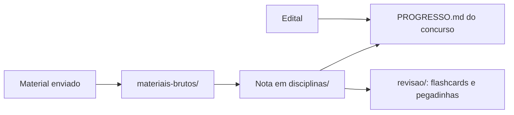

# 📚 Concursos — Base de Estudos

Repositório pessoal de estudos para concursos públicos: editais, notas por disciplina, progresso e revisão.

## 🎯 Concursos

| Concurso | Banca | Prova | Status | Progresso |
|---|---|---|---|---|
| [CGU — AFFC](concursos/cgu-affc/README.md) | a confirmar | a confirmar | ⏳ Aguardando edital | [checklist](concursos/cgu-affc/PROGRESSO.md) |

## 📖 Disciplinas

As notas ficam em [`disciplinas/`](disciplinas/) e são **compartilhadas entre concursos**: o mesmo tópico de Direito Administrativo serve para a CGU e para qualquer outro concurso.

*(Nenhuma disciplina cadastrada ainda. Elas serão criadas a partir do edital.)*

## 🗺️ Como funciona

📁 [`conversas/`](conversas/) → resumos das nossas conversas · [`ideias/`](ideias/) → organização de pensamento

Modelo de nota: [`_templates/nota-topico.md`](_templates/nota-topico.md)
