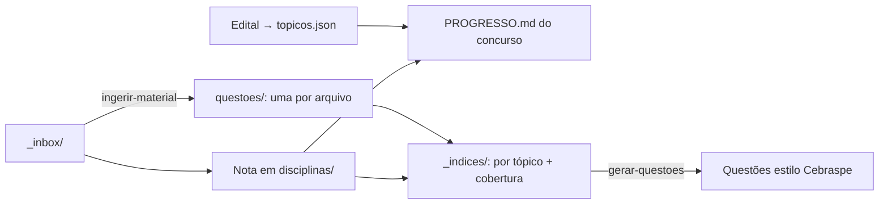

# 📚 Concursos — Base de Estudos

> 🖥️ **[Abrir a Área do Concurseiro](https://metrics-odr.github.io/concursos/)** — explorer do repositório, notas estilo Obsidian, desafios diários, flashcards, acervo e provas.

Repositório pessoal de estudos para concursos públicos: editais, notas por disciplina, progresso e revisão.

## 🎯 Concursos

| Concurso | Banca | Prova | Status | Progresso |
|---|---|---|---|---|
| [CGU — AFFC · TI – Ciência de Dados](concursos/cgu-affc/README.md) | Cebraspe | 13/12/2026 | 📖 Estudando ([edital](concursos/cgu-affc/edital/edital-cgu-2026-12.md) · [acervo](concursos/cgu-affc/acervo/README.md) · [provas](concursos/cgu-affc/revisao/provas-cebraspe.md)) | [checklist](concursos/cgu-affc/PROGRESSO.md) |

## 📖 Disciplinas

As notas ficam em [`disciplinas/`](disciplinas/) e são **compartilhadas entre concursos**: o mesmo tópico de Direito Administrativo serve para a CGU e para qualquer outro concurso.

*(As 13 disciplinas do edital estão no [PROGRESSO](concursos/cgu-affc/PROGRESSO.md); as pastas são criadas conforme as notas forem escritas.)*

## 🗺️ Como funciona

🗂️ [`questoes/`](questoes/README.md) → banco de questões reais (uma por arquivo, com tópicos do edital) · 🎯 [`bancas/cebraspe/`](bancas/cebraspe/perfil.md) → como a banca cobra · 🗺️ [`_indices/cobertura.md`](_indices/cobertura.md) → lacunas do edital

📥 [`_inbox/`](_inbox/README.md) → jogue material novo aqui e peça “processa o inbox” · 💬 numa conversa nova, peça “gere 5 questões da minha prova”

🃏 [`flashcards/`](flashcards/) → banco de flashcards e exportação para o Anki

📁 [`conversas/`](conversas/) → resumos das nossas conversas · [`ideias/`](ideias/) → organização de pensamento

🎯 [`desafios/`](desafios/) → desafio do dia (gerado automaticamente) · ⚙️ [`automacoes/`](automacoes/README.md) → como as rotinas funcionam

Modelo de nota: [`_templates/nota-topico.md`](_templates/nota-topico.md)
