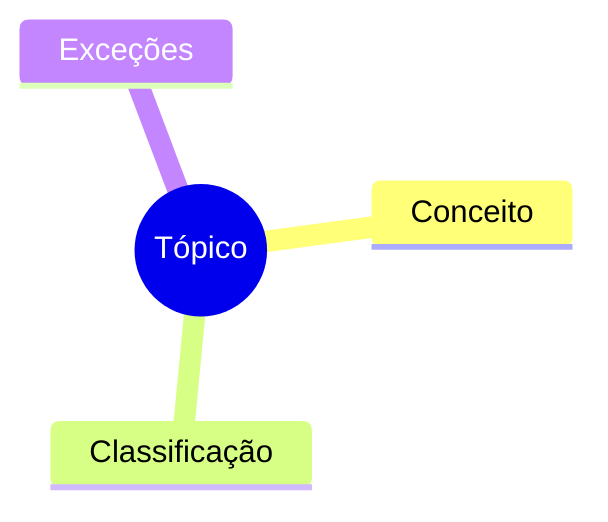

# <Número>. <Título do Tópico>

> **Disciplina:** <disciplina> · **Item do edital:** <concurso> — <item>
> **Fontes:** <material / lei / aula> · **Atualizado em:** AAAA-MM-DD

## 🧭 Visão geral
- Ideia central em 2–3 bullets.

## 📌 Conceitos-chave
- **Termo** → definição curta.
- Causa ⇒ consequência.

## 📊 Comparativo
| Critério | A | B |
|---|---|---|
| ... | ... | ... |

## ⚖️ Base legal
- Lei nº X, art. Y — o que diz, em linguagem direta.

## ⚠️ Pegadinhas de prova
> [!WARNING]
> Afirmação que a banca costuma trocar → versão correta.

## 🃏 Flashcards
| Pergunta | Resposta |
|---|---|
| ... | ... |

## ❓ Questões de fixação
1. (Banca/Ano) Enunciado...
   

Gabarito
Resposta + justificativa.

