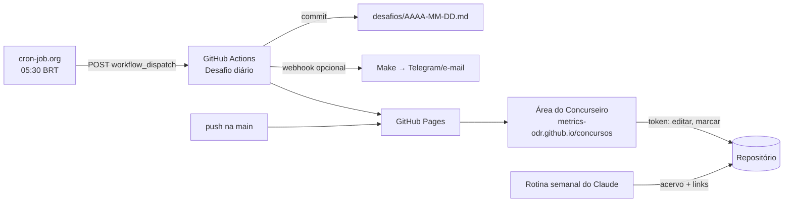

# ⚙️ Automações da Área do Concurseiro



## 🖥️ App — `index.html` + `app/`
- Site estático publicado no **GitHub Pages**: <https://metrics-odr.github.io/concursos/>.
- **Lê** os arquivos direto do GitHub (API → `raw.githubusercontent.com` → cópia do Pages), então notas novas aparecem em ~1 min, sem rebuild.
- **Edita** via API do GitHub com um token *fine-grained* salvo só no navegador (⚙️ no app). Permissão: **Contents: Read and write** apenas em `metrics-odr/concursos`.
- Estilo Obsidian: `[[wikilinks]]`, callouts `> [!TIP]`, `#tags`, Mermaid, frontmatter, “Mencionado em”, busca rápida **Ctrl+K**.
- Checkboxes `- [ ]` e emojis de status ⬜🟨✅🔁 são **clicáveis** e viram commit.

## 🔁 Workflows (`.github/workflows/`)

| Workflow | Quando roda | O que faz |
|---|---|---|
| `pages.yml` — Publicar Área do Concurseiro | push na `main`, manual, ou chamado pelo desafio | valida scripts, monta o site e publica no Pages |
| `desafio-diario.yml` — Desafio diário | cron-job.org (05:30 BRT) + plano B do GitHub (07:17 BRT) | gera `desafios/AAAA-MM-DD.md`, commita, avisa o Make e republica |

Ambos declaram `permissions:` no próprio arquivo — não dependem da opção “Workflow permissions” do repositório.

## ⏰ cron-job.org → dispara o desafio diário
Configuração no cron-job.org (*Create cronjob → Advanced*):

| Campo | Valor |
|---|---|
| URL | `https://api.github.com/repos/metrics-odr/concursos/actions/workflows/desafio-diario.yml/dispatches` |
| Método | `POST` |
| Agenda | todo dia, 05:30, fuso `America/Sao_Paulo` |
| Corpo | `{"ref":"main"}` |

Headers (um por linha no cron-job.org):

| Header | Valor |
|---|---|
| `Accept` | `application/vnd.github+json` |
| `Authorization` | `Bearer TOKEN_AQUI` |
| `X-GitHub-Api-Version` | `2022-11-28` |
| `Content-Type` | `application/json` |
| `User-Agent` | `cron-job-org-concursos` |

`TOKEN_AQUI` → token *fine-grained* só deste repositório com **Actions: Read and write**. Resposta esperada: **HTTP 204**.

## 📣 Make (opcional) → aviso no celular
1. No Make: cenário com **Webhooks → Custom webhook** + módulo de envio (Telegram, Gmail, WhatsApp…).
2. No GitHub: *Settings → Secrets and variables → Actions → New secret* `MAKE_WEBHOOK_URL` = URL do webhook.
3. O desafio diário envia este JSON:

```json
{"data": "2026-10-29", "dias_para_prova": 45, "tarefas": ["Estudar …", "20 itens Cebraspe (…)"], "url": "https://metrics-odr.github.io/concursos/#/desafios", "arquivo": "desafios/2026-10-29.md"}
```

## 🧠 Scripts (`scripts/`)

| Script | Para quê |
|---|---|
| `edital_topicos.py [--progresso]` | edital → `edital/topicos.json` (e checklist do `PROGRESSO.md`) |
| `gerar_acervo.py` | `acervo/curadoria.json` + tópicos → `acervo/<disciplina>.md` com atalhos de busca por tópico |
| `verificar_links.py` | confere os links da curadoria e das provas |
| `gerar_desafio.py [AAAA-MM-DD]` | cria o desafio do dia (idempotente) |
| `gerar_indice.py` | `indice.json` usado como plano B do explorer |

## 🔎 Rotina semanal do Claude (acervo)
Uma tarefa agendada do Claude revisa o acervo: procura novas fontes (vídeos, PDFs, posts, provas Cebraspe), atualiza `curadoria.json`, roda `gerar_acervo.py` e `verificar_links.py` e publica.
