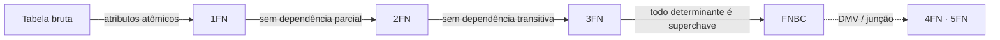

# ED.1.1 — Normalização e integridade (modelo relacional)

> **Disciplina:** Engenharia, Arquitetura e Governança de Dados · **Item do edital:** CGU AFFC — ED.1.1 (“normalização e integridade”)
> **Fontes:** videoaula Bóson Treinamentos em Tecnologia, “Primeira Forma Normal” (slide, 0:14); conceitos clássicos de bancos de dados (Codd; Elmasri & Navathe) · **Atualizado em:** 2026-10-29

> [!NOTE] Verificar:
> Nota escrita a partir de um slide da aula e do conhecimento clássico da área. Conferir as definições com a apostila/livro que você usar (ex.: Elmasri & Navathe, cap. de normalização) antes de dar o tópico como ✅.

## 🧭 Visão geral
- **Normalizar** = organizar as tabelas para reduzir **redundância** e evitar **anomalias** de inserção, atualização e remoção.
- Cada forma normal (FN) **inclui a anterior**: FNBC ⇒ 3FN ⇒ 2FN ⇒ 1FN.
- Base teórica: **dependências funcionais** (DF) — `X → Y` = o valor de X determina o de Y.

## 📌 1FN — Primeira Forma Normal (conteúdo da aula)
- Definida historicamente para **reprovar** atributos **multivalorados**, **compostos** e suas **combinações** (inclusive relações aninhadas).
- O **domínio** de um atributo só pode ter valores **atômicos (indivisíveis)**.
- O valor de qualquer atributo em uma **tupla** deve ser **um único valor** do domínio desse atributo.

| Problema | Exemplo | Correção |
|---|---|---|
| Multivalorado | `telefones = "9999-1111; 8888-2222"` | Nova tabela `Telefone(id_pessoa, telefone)` (1:N) |
| Composto | `endereco = "Rua X, 10, Brasília"` | Atributos simples: `logradouro`, `numero`, `cidade` |
| Aninhado | Pedido com lista de itens dentro da linha | Tabela `ItemPedido(id_pedido, item, qtd)` |

> [!WARNING]
> Corrigir multivalorado criando colunas `tel1, tel2, tel3` **não resolve**: é grupo repetitivo disfarçado (viola o espírito da 1FN e limita o modelo).

## 📌 2FN — Segunda Forma Normal
- Está na **1FN** **e** todo atributo **não chave** depende **funcionalmente de toda a chave** primária — **sem dependência parcial**.
- Só pode ser violada quando a **chave é composta**. Tabela em 1FN com chave **simples** já está na 2FN.
- Correção: decompor, levando o atributo que depende só de **parte** da chave para outra tabela.

Exemplo: `ItemPedido(id_pedido, id_produto, qtd, nome_produto)` — `nome_produto` depende só de `id_produto` ⇒ parcial ⇒ mover para `Produto(id_produto, nome_produto)`.

## 📌 3FN — Terceira Forma Normal
- Está na **2FN** **e** nenhum atributo não chave depende de outro atributo não chave — **sem dependência transitiva** (`chave → A → B`, com A não chave).
- Correção: `A → B` vira tabela própria.

Exemplo: `Funcionario(matricula, cod_depto, nome_depto)` — `matricula → cod_depto → nome_depto` ⇒ criar `Departamento(cod_depto, nome_depto)`.

## 📌 FNBC (Boyce-Codd) e formas superiores
- **FNBC**: para toda DF não trivial `X → Y`, **X é superchave**. É mais rígida que a 3FN (a 3FN tolera `X → Y` se Y for atributo primo; a FNBC não).
- **4FN**: elimina **dependências multivaloradas** não triviais. **5FN**: elimina dependências de **junção** não implicadas pelas chaves.

## 📊 Comparativo
| FN | Pré-requisito | Elimina | Só se aplica a… |
|---|---|---|---|
| 1FN | — | multivalorados, compostos, aninhados | qualquer tabela |
| 2FN | 1FN | dependência **parcial** da chave | chave **composta** |
| 3FN | 2FN | dependência **transitiva** | qualquer tabela |
| FNBC | 3FN | determinante que não é superchave | tabelas com várias chaves candidatas sobrepostas |
| 4FN | FNBC | dependência multivalorada | — |

## 🔑 Integridade (outra metade do ED.1.1)
| Tipo | Garante | Mecanismo SQL |
|---|---|---|
| **Entidade** | PK única e **não nula** | `PRIMARY KEY` |
| **Referencial** | FK aponta para PK existente (ou é nula) | `FOREIGN KEY … REFERENCES`, `ON DELETE/UPDATE` |
| **Domínio** | valor válido para a coluna | tipo, `CHECK`, `NOT NULL`, `DEFAULT` |
| **Unicidade** (chave alternativa) | sem duplicidade fora da PK | `UNIQUE` |
| **Semântica/negócio** | regras da organização | `CHECK`, *triggers* (evento-condição-ação), aplicação |

## ⚖️ Normalizar × desnormalizar
- **OLTP** (transacional): normalizar (até 3FN/FNBC) → menos anomalias, escrita consistente.
- **Analítico / DW** (ED.1.2): desnormalizar de propósito (esquema estrela) → menos junções, leitura rápida; custo = redundância.

## ⚠️ Pegadinhas de prova
> [!WARNING]
> - **2FN ≠ transitiva.** Parcial → 2FN; transitiva → 3FN (o card `eagd-0002` já cobre isso).
> - **“Todos os atributos dependem de toda a chave composta”** = 2FN (certo — CEB-2025-ANM-CD-Q104).
> - 2FN só faz sentido com **chave composta**; “toda tabela com chave simples já está na 2FN” é verdadeiro (dado 1FN).
> - **Atômico** é relativo à aplicação: um endereço pode ser atômico se nunca for consultado por partes — mas a **definição formal** da banca trata o composto como violação.
> - Normalização de banco (formas normais) **≠** normalização de dados em ML (EP.5.1: escalonar variáveis).
> - Normalizar **não** é sempre melhor: em DW é comum desnormalizar.

## 🃏 Flashcards
→ Cards em [`flashcards/banco/engenharia-arquitetura-governanca-dados.csv`](../../flashcards/banco/) (filtrar `topico = normalizacao`). Novos cards só quando você pedir.

## ❓ Questões de fixação
→ Simulado: [`desafios/simulados/prova-claude-29-10-2026-ed-normalizacao.md`](../../desafios/simulados/prova-claude-29-10-2026-ed-normalizacao.md) · gabarito separado no arquivo `gabarito-claude-29-10-2026-ed-normalizacao.md`.
→ Questões reais no banco: [[ceb-2025-anm-cd-q104]] (2FN) · [[ceb-2025-anm-cd-q102]] (UNIQUE).
