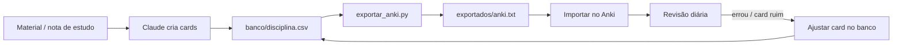

# 🃏 Flashcards

Central de flashcards do repositório: como criar, onde ficam guardados, como revisar e como levar para o Anki.

> [!IMPORTANT]
> **Padrão: itens Cebraspe (Certo/Errado).** Cada erro anula um acerto (+1 / −1; em branco = 0). No app, escolha a matéria no menu (**P1 · P2 · P3**) e use *Estudar* (revisão espaçada) ou *Simulado* (todos os itens, ordem aleatória).

## 📁 O que tem aqui

| Arquivo / pasta | Para quê |
|---|---|
| [`primeiros-passos-anki.md`](primeiros-passos-anki.md) | **Comece aqui**: instalar, configurar e importar no Anki |
| [`como-criar.md`](como-criar.md) | Regras para escrever um bom card + tipos de card com exemplos |
| [`base-de-dados.md`](base-de-dados.md) | Formato do banco (colunas, tags, IDs) |
| [`revisao-espacada.md`](revisao-espacada.md) | Como e quando revisar (repetição espaçada, Anki) |
| [`decisoes.md`](decisoes.md) | Registro das nossas conversas e decisões sobre flashcards |
| [`banco/`](banco/) | **Os cards**: um arquivo `.csv` por disciplina |
| [`scripts/exportar_anki.py`](scripts/exportar_anki.py) | Gera o arquivo pronto para importar no Anki |
| `exportados/` | Saída do script (arquivos para o Anki) |

## 🔄 Fluxo

## 🗂️ Organização

- **Um arquivo por disciplina**: `banco/direito-administrativo.csv`, `banco/contabilidade-publica.csv`…
- **Tags** separam por concurso e tópico, então um card serve para vários concursos:
  `concurso::cgu-affc disciplina::direito-administrativo topico::atos-administrativos`
- No Anki isso vira um **baralho por disciplina**, com tags hierárquicas para filtrar.

## 📊 Bancos

Os nomes de arquivo seguem o `slug` das disciplinas do edital (`concursos/cgu-affc/edital/topicos.json`) → é assim que o app monta o menu **P1 · P2 · P3**.

| Prova | Disciplina | Arquivo | Cards |
|---|---|---|---|
| P1 | Estado, Democracia, Direitos e Ciência Política | [`ciencia-politica-e-estado.csv`](banco/ciencia-politica-e-estado.csv) | 2 |
| P1 | Sociedade Brasileira, Desigualdades, Diversidade e Desenvolvimento | — | 0 |
| P1 | Ética Pública e Responsabilidade Profissional | [`etica-publica.csv`](banco/etica-publica.csv) | 3 |
| P1 | Administração Pública e Fundamentos de Políticas Públicas | [`administracao-publica-e-politicas.csv`](banco/administracao-publica-e-politicas.csv) | 2 |
| P2 | Fundamentos de Governança, Riscos e Integridade Pública e Privada | [`governanca-riscos-integridade.csv`](banco/governanca-riscos-integridade.csv) | 3 |
| P2 | Fundamentos de Transparência, Ouvidoria e Participação Social | [`transparencia-ouvidoria-participacao.csv`](banco/transparencia-ouvidoria-participacao.csv) | 4 |
| P2 | Fundamentos de Direito Público Aplicado, Controle e Responsabilização | [`direito-publico-controle.csv`](banco/direito-publico-controle.csv) | 3 |
| P2 | Fundamentos de Evidências, Dados e Inteligência Artificial | [`evidencias-dados-ia.csv`](banco/evidencias-dados-ia.csv) | 3 |
| P2 | Fundamentos de Auditoria Governamental e Atuação Integrada da CGU | [`auditoria-governamental-cgu.csv`](banco/auditoria-governamental-cgu.csv) | 3 |
| P3 | Estatística, Programação e Análise de Dados | [`estatistica-programacao-analise-dados.csv`](banco/estatistica-programacao-analise-dados.csv) | 9 |
| P3 | Engenharia, Arquitetura e Governança de Dados | [`engenharia-arquitetura-governanca-dados.csv`](banco/engenharia-arquitetura-governanca-dados.csv) | 9 |
| P3 | Aprendizado de Máquina e Inteligência Artificial | [`aprendizado-de-maquina-e-ia.csv`](banco/aprendizado-de-maquina-e-ia.csv) | 11 |
| P3 | Operação, Governança e Gestão de Soluções de Dados e IA | [`operacao-mlops-dados-ia.csv`](banco/operacao-mlops-dados-ia.csv) | 7 |
| — | *(exemplo)* | [`_exemplo.csv`](banco/_exemplo.csv) | 6 |
