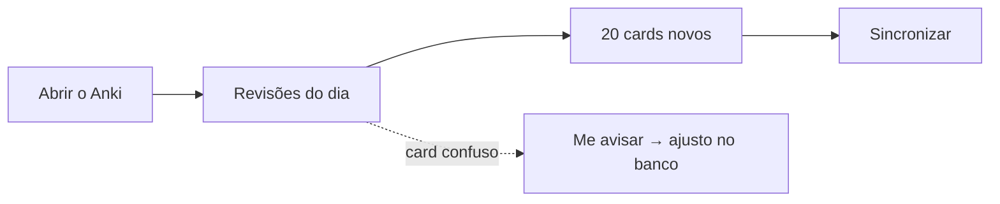

# 🚀 Primeiros passos no Anki (do zero)

Guia para quem nunca usou o Anki. Faça uma vez só; depois é só revisar.

## 1. Instalar e criar conta
| Passo | Onde | O que fazer |
|---|---|---|
| 1 | [ankiweb.net](https://ankiweb.net) | Criar conta grátis (serve para sincronizar computador ↔ celular) |
| 2 | Computador | Baixar o **Anki** em [apps.ankiweb.net](https://apps.ankiweb.net) |
| 3 | Android | Instalar o **AnkiDroid** (grátis, Play Store) |
| 3 | iPhone/iPad | **AnkiMobile** (pago) — ou usar o AnkiWeb pelo navegador, grátis |
| 4 | Nos apps | Entrar com a mesma conta → botão **Sincronizar** |

> [!TIP]
> Importar no **computador** é mais fácil. Depois de sincronizar, os cards aparecem no celular sozinhos.

## 2. Configurar o limite de 20 cards novos por dia
- No Anki do computador: clicar na ⚙️ ao lado do baralho → **Opções**.
- **Limites diários → Novos cards/dia = 20**.
- Deixar **Máximo de revisões/dia** alto (ex.: 9999), para nunca acumular revisões escondidas.

## 3. Importar os cards deste repositório
1. Baixar do GitHub os arquivos em `flashcards/exportados/` (eu gero e envio quando criar cards).
2. Anki → **Arquivo → Importar** → escolher o arquivo.
3. Conferir o **tipo de nota**:

| Arquivo | Tipo de nota no Anki |
|---|---|
| `anki-basico.txt` | Básico |
| `anki-invertido.txt` | Básico (e cartão invertido) |
| `anki-cloze.txt` | Omissão de palavras (Cloze) |

4. **Importar** → sincronizar.

→ Reimportar o mesmo arquivo depois **não duplica** cards: o `id` de cada card atualiza o que já existe.

## 4. Como responder cada card
| Botão | Quando usar |
|---|---|
| **De novo** | Errou ou não lembrou → volta hoje |
| **Difícil** | Acertou com muito esforço |
| **Bom** | Acertou normalmente → **o botão mais usado** |
| **Fácil** | Óbvio demais → intervalo longo |

> [!WARNING]
> Não aperte "Fácil" por pressa. Na dúvida → **Bom**. Errou → **De novo**, sem culpa: é assim que o algoritmo aprende.

## 5. O que esperar da carga
- 20 novos/dia ⇒ depois de algumas semanas, algo em torno de **100–200 revisões/dia** (estimativa; depende dos seus acertos).
- Dá ~20–40 min/dia. Se ficar pesado → baixar para 10–15 novos/dia, **nunca** pular as revisões.

