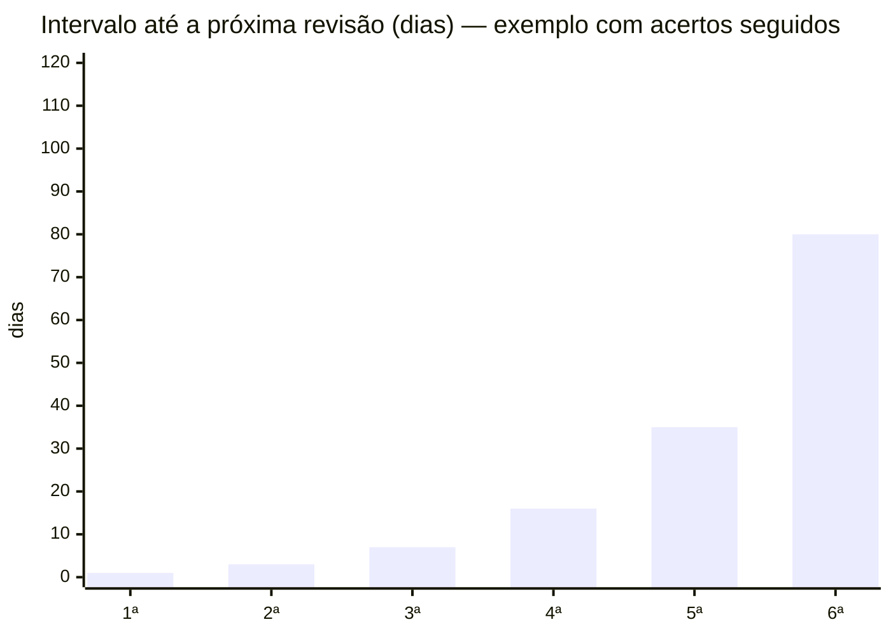

# 🔁 Revisão espaçada

## A ideia
Revisar **logo antes de esquecer**. Cada acerto empurra a próxima revisão para mais longe; cada erro traz o card de volta.

## 📱 Ferramenta: Anki (recomendada)
| Plataforma | App | Custo |
|---|---|---|
| Windows / Mac / Linux | Anki | grátis |
| Android | AnkiDroid | grátis |
| iPhone / iPad | AnkiMobile | pago |
| Navegador | AnkiWeb | grátis (sincroniza tudo) |

→ O Anki calcula os intervalos sozinho. Você só responde **De novo / Difícil / Bom / Fácil**.

## ⚙️ Rotina sugerida
- **Todo dia**, mesmo que pouco: 15–30 min, de preferência no mesmo horário.
- **Cards novos:** **20 por dia** (definido em 2026-10-28). Novos demais hoje ⇒ montanha de revisões em uma semana.
- **Revisões primeiro**, cards novos depois.
- Errou de novo e de novo ⇒ o card vai para ajuste (ver [`como-criar.md`](como-criar.md)).

## 📆 Perto da prova
| Quando | O que fazer |
|---|---|
| 60–30 dias | Reduzir cards novos; foco em disciplinas de maior peso |
| 30–7 dias | Parar de adicionar novos; só revisões + `tipo::vf` (pegadinhas) |
| Últimos dias | Revisar cards marcados como difíceis e os de leis com maior incidência |
