# 01. A CGU por dentro: o que é, para que serve, como se organiza e como atua

> **Biblioteca:** Fundamentos · **Concurso:** CGU — AFFC (todas as especialidades)
> **Itens do edital ligados:** Conhecimentos básicos → *Fundamentos de auditoria governamental e atuação integrada da CGU*; *Fundamentos de direito público aplicado, controle e responsabilização*; *Fundamentos de governança, riscos e integridade*; *Fundamentos de transparência, ouvidoria e participação social* · Anexo IV (atribuições do cargo)
> **Fontes:** CF/1988, arts. 70 e 74 · Lei nº 14.600/2023 (organização dos ministérios) · Decreto nº 11.330/2023 (estrutura regimental da CGU, texto consolidado na Câmara dos Deputados, consultado em 2026-10-28) · Lei nº 10.180/2001 · Decreto nº 3.591/2000 · Lei nº 12.846/2013 · Lei nº 12.527/2011 · Lei nº 13.460/2017 · Lei nº 9.625/1998, art. 22 e Portaria CGU nº 814/2020 (ambas transcritas no [Anexo IV do edital](../concursos/cgu-affc/edital/edital-cgu-2026-12.md#anexo-iv))
> **Atualizado em:** 2026-10-28

> [!NOTE]
> Esta é uma nota de **fundamentos**: o mapa da instituição em que você vai trabalhar. Os detalhes de cada lei (LAI, Lei Anticorrupção, Lei 8.112, etc.) vão para as notas próprias em `disciplinas/`. Aqui a ideia é entender **como as peças se encaixam**, porque o edital de 2026 cobra exatamente isso ("atuação integrada da CGU", "distinção entre avaliar, apurar e sancionar").

---

## Sumário
1. [Visão geral em 1 minuto](#-1-visão-geral-em-1-minuto)
2. [O que é a CGU (natureza jurídica e lugar no Estado)](#-2-o-que-é-a-cgu)
3. [Breve história](#-3-breve-história)
4. [Para que serve: as 11 áreas de competência](#-4-para-que-serve-as-11-áreas-de-competência)
5. [Os 4 sistemas de que a CGU é órgão central](#-5-os-4-sistemas-de-que-a-cgu-é-órgão-central)
6. [Como é subdividida (estrutura regimental)](#-6-como-é-subdividida)
7. [Como a CGU atua, função por função](#-7-como-a-cgu-atua-função-por-função)
8. [Como a CGU fiscaliza: o ciclo de um trabalho de auditoria](#-8-como-a-cgu-fiscaliza-o-ciclo-de-um-trabalho)
9. [A atuação integrada: como as funções se alimentam](#-9-a-atuação-integrada)
10. [CGU × TCU × outros órgãos de controle](#-10-cgu--tcu--outros-órgãos-de-controle)
11. [Ferramentas, sistemas e produtos da CGU](#-11-ferramentas-sistemas-e-produtos)
12. [O cargo de AFFC: atribuições legais](#-12-o-cargo-de-affc-atribuições-legais)
13. [Como cada especialidade contribui no ecossistema](#-13-como-cada-especialidade-contribui)
14. [Pegadinhas de prova](#-14-pegadinhas-de-prova)
15. [Questões de fixação (estilo Cebraspe)](#-15-questões-de-fixação-estilo-cebraspe)

---

## 🧭 1. Visão geral em 1 minuto

- A **CGU** é o **órgão de controle interno do Poder Executivo federal**, com status de **ministério**.
- Missão em uma frase → **proteger o patrimônio público e melhorar a gestão**, prevenindo, detectando e corrigindo problemas no uso de recursos federais.
- Ela faz isso por **quatro grandes macrofunções**, que conversam entre si:

| Macrofunção | Pergunta que responde | Unidade principal |
|---|---|---|
| 🔍 **Auditoria e fiscalização** (controle interno) | "O dinheiro público está sendo bem usado? A política entrega resultado?" | Secretaria Federal de Controle Interno (SFC) |
| ⚖️ **Correição** | "Quem errou? Qual a sanção?" (agentes públicos e empresas) | Corregedoria-Geral da União (CRG) e Secretaria de Integridade Privada |
| 📣 **Ouvidoria** | "O que o cidadão está dizendo/denunciando?" | Ouvidoria-Geral da União (OGU) |
| 🛡️ **Integridade e transparência** (prevenção) | "Como evitar que o problema aconteça e deixar tudo visível?" | Secretaria de Integridade Pública e Secretaria Nacional de Transparência e Acesso à Informação |

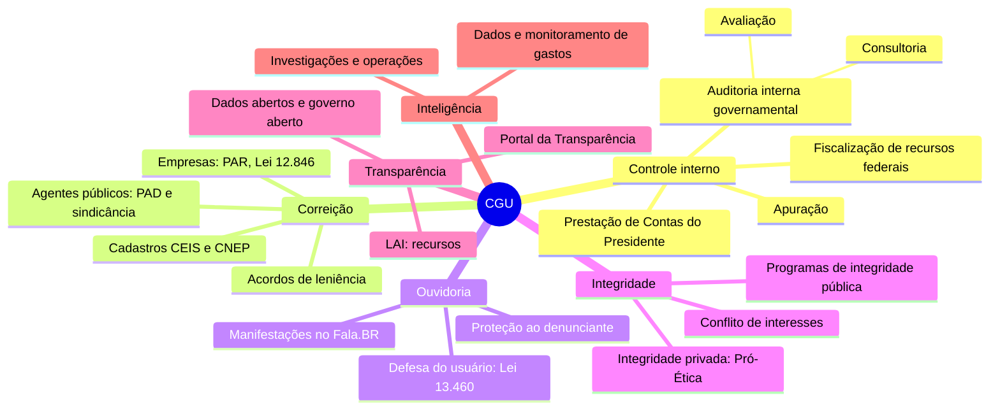

---

## 🏛️ 2. O que é a CGU

### 2.1 Natureza jurídica
- **Órgão** (não é entidade) da **administração pública direta** federal → **não tem personalidade jurídica** própria; age em nome da União.
- **Não** é órgão da Presidência da República: hoje a CGU é um **ministério**, chefiado pelo **Ministro de Estado da Controladoria-Geral da União** (Lei nº 14.600/2023 lista a CGU entre os ministérios).
- Pertence ao **Poder Executivo** → por isso faz **controle interno** (o controle do próprio Poder sobre si mesmo).

### 2.2 Onde ela se encaixa no controle da Administração

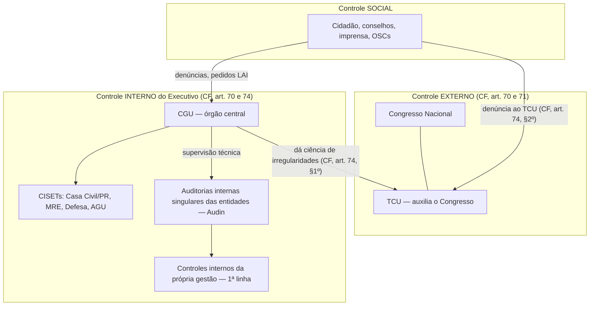

### 2.3 Base constitucional — CF, art. 74 (finalidades do controle interno)
Os Poderes manterão, **de forma integrada**, sistema de controle interno com a finalidade de:
1. **avaliar o cumprimento das metas do PPA**, a execução dos programas de governo e dos orçamentos da União;
2. **comprovar a legalidade e avaliar os resultados**, quanto à **eficácia e eficiência**, da gestão orçamentária, financeira e patrimonial nos órgãos e entidades da administração federal, bem como da aplicação de recursos públicos por **entidades de direito privado**;
3. exercer o **controle das operações de crédito, avais e garantias**, bem como dos direitos e haveres da União;
4. **apoiar o controle externo** no exercício de sua missão institucional.

- **§ 1º** → os responsáveis pelo controle interno, ao tomarem conhecimento de irregularidade, **darão ciência ao TCU, sob pena de responsabilidade solidária**.
- **§ 2º** → qualquer cidadão, partido, associação ou sindicato pode **denunciar ao TCU**.

> [!IMPORTANT]
> O art. 74 é a "certidão de nascimento" da função de controle interno. Repare que ele já fala em **resultados, eficácia e eficiência**, não só em legalidade. Por isso a CGU faz **auditoria de desempenho e avaliação de políticas públicas**, não apenas conferência de notas fiscais.

### 2.4 Base legal infraconstitucional (mapa rápido)

| Norma | O que define para a CGU |
|---|---|
| **Lei nº 14.600/2023** | Organiza os ministérios; lista as **áreas de competência** da CGU |
| **Decreto nº 11.330/2023** (e alterações de 2024–2025) | **Estrutura regimental**: unidades e competências de cada uma |
| **Lei nº 10.180/2001** (arts. 19 a 24) | Organiza o **Sistema de Controle Interno do Poder Executivo Federal** e suas finalidades |
| **Decreto nº 3.591/2000** | Regulamenta o Sistema de Controle Interno (órgão central, órgãos setoriais, CCCI) |
| **Decreto nº 5.480/2005** | **Sistema de Correição** do Poder Executivo Federal (SisCor) |
| **Decreto nº 9.492/2018** | **Sistema de Ouvidoria** do Poder Executivo Federal (SisOuv) |
| **Decreto nº 11.529/2023** | **Sistema de Integridade, Transparência e Acesso à Informação** (Sitai) |
| **Lei nº 12.846/2013** + Decreto nº 11.129/2022 | Responsabilização de **pessoas jurídicas** (PAR) e **acordo de leniência** — CGU com competência no Executivo federal |
| **Lei nº 12.527/2011** (LAI) + Decreto nº 7.724/2012 | CGU como **instância recursal** e monitora a aplicação da LAI |
| **Lei nº 13.460/2017** | Direitos do **usuário de serviço público** e ouvidorias |
| **Lei nº 12.813/2013** | **Conflito de interesses** — CGU fiscaliza e avalia (exceto altas autoridades sob a Comissão de Ética Pública) |
| **Lei nº 9.625/1998** (art. 22) e **Portaria CGU nº 814/2020** | **Atribuições do cargo** de AFFC |

> [!NOTE] Verificar:
> O Decreto nº 11.330/2023 foi alterado várias vezes (ex.: Decretos nº 12.219/2024, 12.522/2025 e 12.776/2025). Os nomes de diretorias abaixo foram conferidos no **texto consolidado da Câmara** em 2026-10-28, mas não consegui confirmar o conteúdo exato do Decreto 12.776/2025 (de dez/2025). Antes da prova, conferir no Planalto se alguma unidade foi criada, extinta ou renomeada.

---

## 📜 3. Breve história

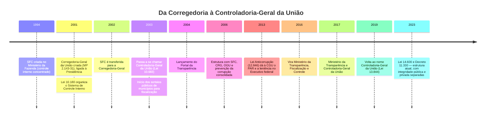

> [!NOTE] Verificar:
> Datas de 1994 (criação da SFC) e 2006 (consolidação das unidades) são de memória/doutrina geral, não conferidas na fonte primária. Para a prova, o que importa é: **2001 (origem como Corregedoria)**, **2003 (nome CGU)**, **2013 (Lei Anticorrupção)** e **2023 (estrutura atual)**.

→ Repare no movimento: o órgão nasceu **correcional** (punir), incorporou a **auditoria** (SFC), depois **ouvidoria** e **prevenção/transparência**. Hoje o discurso institucional é o de **"controle que melhora a gestão"**, e não só o de "controle que pune".

---

## 🎯 4. Para que serve: as 11 áreas de competência

Pela **Lei nº 14.600/2023** (repetida no art. 1º do Anexo I do Decreto nº 11.330/2023), constituem áreas de competência da CGU:

| # | Área | Em linguagem direta | Quem cuida (principal) |
|:-:|---|---|---|
| I | **Defesa do patrimônio público** | Missão-síntese de tudo | Toda a CGU |
| II | **Controle interno e auditoria governamental** | Auditar órgãos, entidades e recursos federais | SFC |
| III | **Fiscalização e avaliação de políticas públicas e programas de governo** | A política funciona? Chega a quem precisa? | SFC |
| IV | **Integridade pública e privada** | Programas de integridade nos órgãos e nas empresas | Sec. Integridade Pública / Sec. Integridade Privada |
| V | **Correição e responsabilização** de agentes públicos e de entes privados | PAD, PAR, leniência, cadastros de sanção | CRG / Sec. Integridade Privada |
| VI | **Prevenção e combate a fraudes e à corrupção** | Inteligência, investigações, operações | SE (Dir. Pesquisas e Inf. Estratégicas) / SFC (Dir. Investigações e Operações) |
| VII | **Ouvidoria** | Receber, tratar e responder manifestações | OGU |
| VIII | **Incremento da transparência, dos dados abertos e do acesso à informação** | LAI, Portal da Transparência, dados abertos | Sec. Nacional de Transparência e Acesso à Informação |
| IX | **Promoção da ética pública e prevenção do nepotismo e dos conflitos de interesses** | Lei 12.813, Decreto do nepotismo | Sec. Integridade Pública |
| X | **Suporte à gestão de riscos** | Ajudar os gestores a gerir riscos (não gerir por eles!) | SFC / Sec. Integridade Pública |
| XI | **Articulação com organismos internacionais** e órgãos nacionais/estrangeiros | OCDE, ONU (UNCAC), OEA (MESICIC), G20 | Assessoria Internacional |

> [!TIP]
> Mnemônico das 11 áreas: **"PAPI-CO-FOTE-RIA"** → **P**atrimônio · **A**uditoria · **P**olíticas · **I**ntegridade · **CO**rreição · **F**raudes · **O**uvidoria · **T**ransparência · **E**tica · **RI**scos · **A**rticulação internacional.

---

## 🔗 5. Os 4 sistemas de que a CGU é órgão central

Um "sistema" na Administração federal = **rede de unidades** espalhadas pelos órgãos, com um **órgão central** que **normatiza, orienta, supervisiona e avalia**. As unidades setoriais continuam **subordinadas administrativamente** ao seu órgão, mas **tecnicamente** seguem o órgão central.

| Sistema | Norma | Órgão central (unidade da CGU) | Unidades setoriais / seccionais |
|---|---|---|---|
| **Sistema de Gestão de Riscos e Controle Interno** do Poder Executivo federal | Lei 10.180/2001; Decreto 3.591/2000 | **SFC** | CISETs (Casa Civil/PR, MRE, Defesa, AGU); **auditorias internas (Audin)** das autarquias, fundações e estatais |
| **Sistema de Correição** (SisCor) | Decreto 5.480/2005 | **CRG** | Corregedorias setoriais e seccionais dos órgãos e entidades |
| **Sistema de Ouvidoria** (SisOuv) | Decreto 9.492/2018 | **OGU** | Ouvidorias dos órgãos e entidades |
| **Sistema de Integridade, Transparência e Acesso à Informação** (Sitai) | Decreto 11.529/2023 | **CGU** (Sec. Integridade Pública e Sec. Nac. de Transparência e Acesso à Informação) | Unidades de gestão da integridade (UGI) / autoridades de monitoramento da LAI nos órgãos |

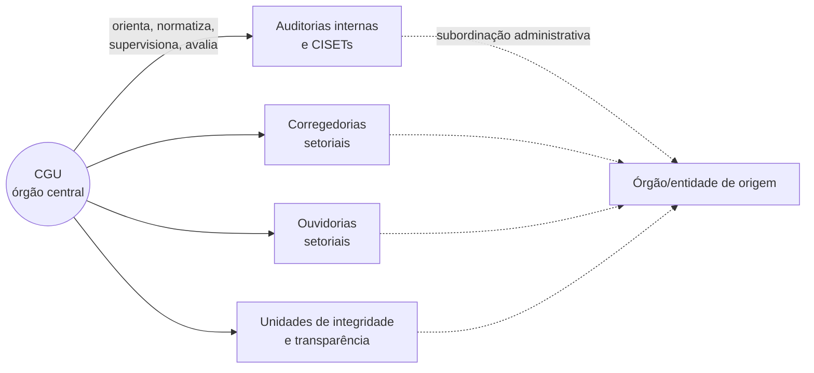

> [!WARNING]
> **Pegadinha clássica:** as CISETs (ex.: da Defesa, do MRE, da AGU, da Casa Civil) **não são unidades da CGU**. Elas são **órgãos setoriais** do Sistema de Controle Interno, ficam na estrutura do respectivo ministério e **se sujeitam à orientação normativa e supervisão técnica** do órgão central (CGU/SFC). Por isso o art. 14, § 2º, do Decreto 11.330/2023 afasta, em regra, a atuação das diretorias de auditoria da SFC sobre **Presidência, Vice-Presidência, AGU, MRE e Defesa** (há exceções previstas no próprio dispositivo).

> [!NOTE] Verificar:
> A lista exata de CISETs e o nome atual do sistema de controle interno ("Sistema de Gestão de Riscos e Controle Interno") foram tirados do art. 1º do Anexo I do Decreto 11.330/2023 consolidado; o Decreto 3.591/2000 usa a denominação histórica "Sistema de Controle Interno do Poder Executivo Federal". Conferir a CISET da Casa Civil/Presidência no texto atual do Decreto 3.591/2000.

---

## 🏗️ 6. Como é subdividida

Estrutura do **art. 3º do Anexo I do Decreto nº 11.330/2023** (texto consolidado):

```mermaid
flowchart TB
    MIN[Ministro de Estado da CGU]

    MIN --> AD[Órgãos de assistência direta e imediata]
    MIN --> OES[Órgãos específicos singulares]
    MIN --> DESC[Unidades descentralizadas]
    MIN --> COL[Órgãos colegiados]

    AD --> GAB[Gabinete]
    AD --> ASCOM[Assessoria Especial de Comunicação Social]
    AD --> AINT[Assessoria Especial para Assuntos Internacionais]
    AD --> APAR[Assessoria p/ Assuntos Parlamentares e Federativos]
    AD --> APS[Assessoria Especial de Participação Social e Diversidade]
    AD --> SE[Secretaria-Executiva]
    AD --> CONJUR[Consultoria Jurídica]

    SE --> DGC[Dir. Gestão Corporativa]
    SE --> DTI[Dir. Tecnologia da Informação]
    SE --> DIE[Dir. Pesquisas e Informações Estratégicas]
    SE --> DPIS[Dir. Planejamento, Inovação e Sustentabilidade]

    OES --> SFC[Secretaria Federal de Controle Interno — SFC]
    OES --> OGU[Ouvidoria-Geral da União — OGU]
    OES --> CRG[Corregedoria-Geral da União — CRG]
    OES --> SIPRI[Secretaria de Integridade Privada]
    OES --> SIP[Secretaria de Integridade Pública]
    OES --> SNAI[Secretaria Nacional de Transparência<br/>e Acesso à Informação]

    DESC --> CGUR[Controladorias Regionais da União<br/>nos Estados — CGU-R]
    COL --> CTICC[Conselho de Transparência, Integridade<br/>e Combate à Corrupção]
    COL --> CCCI[Comissão de Coordenação<br/>de Controle Interno — CCCI]
```

### 6.1 Órgãos de assistência direta e imediata ao Ministro

| Unidade | Papel |
|---|---|
| **Gabinete** (art. 4º) | Representação política e social do Ministro, relações institucionais |
| **Assessorias especiais** (arts. 5º a 7º-A) | Comunicação social; assuntos internacionais (OCDE, ONU, OEA, G20); assuntos parlamentares e federativos; participação social e diversidade |
| **Secretaria-Executiva — SE** (art. 8º) | "Gerente" do ministério: coordena as unidades, planejamento estratégico, governança interna, sistemas administrativos (pessoal, orçamento, TI). **As Controladorias Regionais são subordinadas à SE** (art. 32) |
| ↳ Dir. Gestão Corporativa (art. 9º) | Logística, licitações e contratos, pessoas, orçamento da própria CGU |
| ↳ **Dir. Tecnologia da Informação — DTI** (art. 10) | Sistemas, infraestrutura e segurança da informação da CGU → **casa natural dos Cargos 3 e 4** |
| ↳ **Dir. Pesquisas e Informações Estratégicas — DIE** (art. 11) | **Inteligência de dados**, gestão de ambiente centralizado de dados, **monitoramento contínuo dos gastos públicos**, análise de **evolução patrimonial** de agentes públicos, apoio à análise de indicados pela Casa Civil, intercâmbio com o **Coaf** → **casa natural do Cargo 2** |
| ↳ Dir. Planejamento, Inovação e Sustentabilidade (art. 11-A) | Planejamento estratégico, inovação e sustentabilidade institucional |
| **Consultoria Jurídica — Conjur** (art. 12) | Órgão setorial da **AGU** dentro da CGU: pareceres, análise de minutas, editais e contratos |

### 6.2 Órgãos específicos singulares (a "atividade-fim")

#### 🔍 Secretaria Federal de Controle Interno — SFC (arts. 13 a 14-A)
- **Órgão central do Sistema de Gestão de Riscos e Controle Interno**.
- Faz **auditorias e fiscalizações**; **apura** atos e fatos irregulares na aplicação de recursos públicos federais; **coordena a elaboração da Prestação de Contas anual do Presidente da República** (CF, art. 84, XXIV); exerce **supervisão técnica** das auditorias internas do Executivo federal.
- Diretorias **temáticas** de auditoria (art. 14) → cada uma "cobre" um conjunto de ministérios/políticas:

| Diretoria de Auditoria de... | Exemplos de objeto (ilustrativo) |
|---|---|
| **Políticas Econômicas e de Desenvolvimento** | Fazenda, Planejamento, agricultura, indústria, ciência e tecnologia |
| **Políticas Sociais e de Segurança Pública** | Saúde, Educação, Desenvolvimento Social, Justiça e Segurança |
| **Previdência e Benefícios** | INSS, benefícios previdenciários e assistenciais, folha de pessoal |
| **Políticas de Infraestrutura** | Transportes, energia, cidades, saneamento, obras |
| **Governança e Gestão** | Governança, gestão de pessoas, contratações, TI no governo, transferências |
| **Estatais** | Empresas públicas e sociedades de economia mista federais |

- **Diretoria de Investigações e Operações** (art. 14-A) → executa **ações investigativas** e **operações especiais**, em conjunto com **Polícia Federal, Ministério Público** e outros órgãos de defesa do Estado, em apurações **sigilosas** sobre recursos federais.

> [!NOTE] Verificar:
> A coluna "exemplos de objeto" é ilustrativa (dedução a partir dos nomes das diretorias). O § 1º do art. 14 detalha as competências exatas de cada diretoria — vale ler no texto consolidado.

#### ⚖️ Corregedoria-Geral da União — CRG (arts. 18 a 20)
- **Órgão central do SisCor** (Sistema de Correição).
- Supervisiona a aplicação das leis de responsabilização; faz **inspeções** nas corregedorias; analisa denúncias e representações; **instaura, requisita, recomenda ou avoca** procedimentos disciplinares; emite **certidões** e gere cadastros de sanções (**CEIS**, **CNEP**).
- Diretorias: **Articulação, Monitoramento e Supervisão do Sistema de Correição** (art. 19) e **Responsabilização de Agentes Públicos** (art. 20).

#### 🏢 Secretaria de Integridade Privada (arts. 21 a 24)
- Cuida da relação **Estado ↔ empresas**: responsabilização de **pessoas jurídicas** (Lei 12.846/2013) e **acordos de leniência**.
- Faz o **juízo de admissibilidade** das propostas de leniência, acompanha o cumprimento das cláusulas e **propõe ao Ministro** a celebração ou rejeição do acordo.
- Diretorias: **Acordos de Leniência** (art. 22), **Responsabilização de Entes Privados** (art. 23 — conduz o **PAR**) e **Promoção e Avaliação de Integridade Privada** (art. 24 — ex.: **Pró-Ética**, avaliação de programas de *compliance*).

#### 🛡️ Secretaria de Integridade Pública (arts. 25 a 26-A)
- Coordena a **integridade dentro dos órgãos públicos** (Sitai).
- **Diretoria de Integridade Pública** (art. 26) → normas, guias e metodologias de **programas de integridade**, monitoramento dos planos de integridade dos órgãos.
- **Diretoria de Prevenção a Conflito de Interesses** (art. 26-A) → **Lei 12.813/2013**: consultas e pedidos de autorização (sistema **SeCI**), prevenção de **nepotismo**.

#### 📣 Ouvidoria-Geral da União — OGU (arts. 15 a 17)
- **Órgão central do SisOuv**.
- Supervisiona as ouvidorias federais, capacita, **recebe manifestações** (denúncias, reclamações, sugestões, elogios, solicitações, simplifique) pela plataforma **Fala.BR**, protege **denunciantes** e pode **requisitar informações** aos órgãos.
- Diretorias: **Articulação, Monitoramento e Supervisão do Sistema de Ouvidorias** (art. 16) e **Proteção e Defesa do Usuário de Serviço Público** (art. 17 — Lei 13.460/2017).

#### 🔓 Secretaria Nacional de Transparência e Acesso à Informação (arts. 29 a 31-A)
- Supervisiona a **LAI** no Executivo federal; **julga recursos** de acesso à informação dirigidos à CGU (Decreto 7.724/2012); elabora o **relatório anual** de implementação da LAI; promove **governo aberto** e **dados abertos**.
- Diretorias: **Recursos e Entendimentos de Acesso à Informação** (art. 30), **Articulação, Supervisão e Monitoramento de Acesso à Informação** (art. 31) e **Governo Aberto e Transparência** (art. 31-A — gere o **Portal da Transparência** e o **Portal de Dados Abertos**).

### 6.3 Unidades descentralizadas — Controladorias Regionais da União nos Estados (art. 32)
- Uma **CGU-R** em cada estado (o DF é atendido pelo órgão central).
- **Subordinadas à Secretaria-Executiva**, mas com **supervisão técnica** das unidades centrais (SFC, CRG, OGU etc.) → **dupla vinculação**: administrativa (SE) × técnica (unidade finalística).
- Executam **fiscalizações em municípios e estados** que recebem recursos federais, auditorias nas unidades federais nos estados, apoio a operações especiais, capacitação de gestores locais.

> [!IMPORTANT]
> O edital de 2026 oferece vagas do **Cargo 1 – Auditoria** para **Unidades Regionais (AC, AP, MT, RO, RR)**. Quem for lotado lá trabalha muito com **transferências federais a municípios** (saúde, educação, assistência), **fiscalização in loco** e **operações especiais**.

### 6.4 Órgãos colegiados
| Colegiado | Base | Papel |
|---|---|---|
| **Conselho de Transparência, Integridade e Combate à Corrupção** (art. 33) | Decreto 11.528/2023 | Instância consultiva com participação da sociedade civil, que debate e sugere políticas anticorrupção e de transparência |
| **Comissão de Coordenação de Controle Interno — CCCI** (art. 34) | Decreto 3.591/2000, art. 10 | Colegiado de coordenação do Sistema de Controle Interno: uniformiza entendimentos, harmoniza a atuação de CGU e CISETs |

---

## ⚙️ 7. Como a CGU atua, função por função

### 7.1 🔍 Controle interno — as três formas de atuação da SFC

O edital (Fundamentos de auditoria, item 1.3) cobra expressamente "**finalidades e diferenças entre as três formas de atuação da SFC**". Elas são:

| | **Avaliação** | **Consultoria** | **Apuração** |
|---|---|---|---|
| **Natureza** | Serviço de auditoria interna governamental | Serviço de auditoria interna governamental | **Competência do sistema de controle interno** (não é "serviço de auditoria" em sentido estrito) |
| **Objetivo** | Opinião **independente** sobre governança, riscos, controles e resultados | **Assessoramento** à gestão para agregar valor e melhorar processos | Esclarecer **atos e fatos com indícios de ilegalidade ou irregularidade** no uso de recursos públicos federais |
| **Quem define o escopo** | A unidade de auditoria (com base em risco) | Acordado **com o gestor** que demandou | O fato/indício (denúncia, representação, demanda de órgão de defesa do Estado, achado anterior) |
| **Gatilho típico** | Plano anual baseado em riscos | Pedido da gestão | Denúncia, notícia, operação, cruzamento de dados |
| **Produto** | Relatório com **achados e recomendações** | Pareceres, orientação, treinamento, facilitação | Relatório de apuração → subsidia **correição, PAR, TCU, MPF, PF, AGU** |
| **Postura** | Independência e objetividade | Independência preservada: **não assume responsabilidade de gestão** | Ceticismo e rigor probatório; frequentemente **sigilo** |

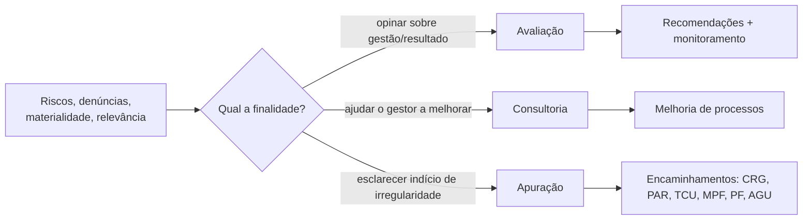

> [!WARNING]
> **Avaliar ≠ apurar ≠ sancionar.** A auditoria **não aplica sanção**. Ela produz **evidência e recomendação**; quem aplica penalidade a servidor é a **autoridade competente em processo correcional** (PAD/sindicância), e a empresas, em **PAR**. O edital insiste nessa distinção (Direito público aplicado, item 3.4).

**Referenciais técnicos da auditoria interna governamental**
- **Referencial Técnico da Atividade de Auditoria Interna Governamental do Poder Executivo Federal** — IN SFC nº 3/2017.
- **Manual de Orientações Técnicas** — IN SFC nº 8/2017.
- Base internacional: normas do **IIA** (Normas Globais de Auditoria Interna, 2024) e **modelo das Três Linhas** (IIA, 2020).
- Normas de governança: **Decreto nº 9.203/2017** (política de governança da administração federal) e **IN Conjunta MP/CGU nº 1/2016** (controles internos, gestão de riscos e governança).

> [!NOTE] Verificar:
> Confirmar se a IN SFC 3/2017 continua vigente ou se foi substituída/atualizada para incorporar as Normas Globais do IIA (2024). Buscar no site da CGU "Referencial Técnico da Atividade de Auditoria Interna Governamental".

**Modelo das Três Linhas aplicado ao Executivo federal**

| Linha | Quem | Papel |
|---|---|---|
| **Órgão de governança** | Alta administração, conselhos | Presta contas, define apetite a risco, supervisiona |
| **1ª linha** | Gestores operacionais | **Executam** a política e **são donos dos riscos e controles** |
| **2ª linha** | Gestão de riscos, integridade, conformidade, controladoria | Apoiam e monitoram a 1ª linha (expertise, supervisão) |
| **3ª linha** | **Auditoria interna** (CGU, CISETs, Audins) | **Avaliação e consultoria independentes** |
| Prestadores externos | **TCU**, auditores externos | Avaliação externa (controle externo) |

> [!TIP]
> No Executivo federal a CGU é **3ª linha**, mas o "suporte à gestão de riscos" (área X) a coloca também como **orientadora** da 2ª linha. A pegadinha é dizer que a CGU **gere os riscos** dos órgãos → errado: o **gestor** é dono do risco; a CGU **avalia e orienta**.

**Outras atividades de controle interno da SFC**
- **Prestação de Contas do Presidente da República (PCPR)** → a SFC coordena a elaboração; vai ao Congresso, com parecer prévio do TCU (CF, arts. 71, I, e 84, XXIV).
- **Auditoria anual de contas** de unidades prestadoras de contas ao TCU e **auditoria das demonstrações financeiras**.
- **Atos de pessoal**: análise da legalidade de **admissões, aposentadorias e pensões** (Portaria 814/2020, art. 3º, IX) antes do registro pelo TCU.
- **Avaliação de políticas públicas** (ex.: CMAP — Conselho de Monitoramento e Avaliação de Políticas Públicas, do qual a CGU participa).
- **Supervisão técnica** e **avaliação de desempenho** das Audins.
- **Processos de novação de dívida** (FCVS — Fundo de Compensação de Variações Salariais) (Portaria 814/2020, art. 2º, XI).

> [!NOTE] Verificar:
> A participação da CGU no CMAP (Decreto nº 9.834/2019) e o detalhe sobre FCVS na novação de dívida são de conhecimento geral, não conferidos na fonte primária nesta nota.

### 7.2 ⚖️ Correição — responsabilizar agentes públicos

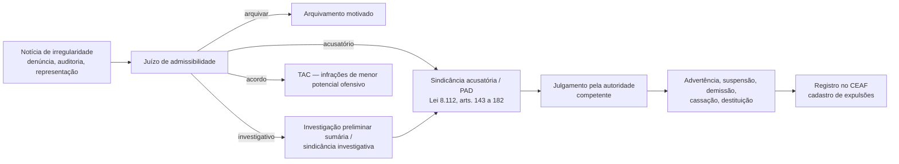

- A CRG **normatiza e supervisiona** as corregedorias dos órgãos; em regra a apuração é feita **no próprio órgão** do servidor.
- A CGU pode **avocar** processos (art. 51, V e VI, da Lei 13.844/2019, citado na Portaria 814/2020; hoje correspondente na Lei 14.600/2023) e **instaurar diretamente** em casos relevantes (omissão do órgão, envolvimento de autoridades, complexidade).
- Instrumentos: **juízo de admissibilidade**, **investigação preliminar sumária**, **sindicância** (investigativa ou acusatória), **PAD**, **TAC** (Termo de Ajustamento de Conduta), **sindicância patrimonial** (enriquecimento ilícito).
- Sistemas: **e-PAD / CGU-PAD** (registro dos processos), **CEAF** (Cadastro de Expulsões da Administração Federal).

> [!NOTE] Verificar:
> Conferir o artigo da **Lei 14.600/2023** que hoje corresponde ao art. 51, V e VI, da Lei 13.844/2019 (avocação/instauração de procedimentos pela CGU) e a norma vigente que consolida o regime correcional (Portaria Normativa CGU nº 27/2022 — confirmar número e vigência).

### 7.3 🏢 Responsabilização de empresas e acordos de leniência (Lei 12.846/2013)

| Instrumento | O que é | Papel da CGU |
|---|---|---|
| **PAR** — Processo Administrativo de Responsabilização | Processo contra **pessoa jurídica** por atos lesivos à administração (art. 5º): suborno, fraude a licitação, etc. — responsabilidade **objetiva** | No Executivo federal a CGU tem **competência concorrente** para instaurar e pode **avocar** PARs abertos em outros órgãos (art. 8º, § 2º); **exclusiva** nos atos contra **administração pública estrangeira** (art. 9º) |
| **Sanções** | **Multa** de 0,1% a 20% do faturamento bruto + **publicação extraordinária** da decisão (art. 6º) | Aplicadas pela autoridade máxima / Ministro da CGU |
| **Acordo de leniência** | Empresa colabora (identifica envolvidos, entrega provas), **cessa** a conduta, **admite** participação e **repara** o dano → redução de até **2/3 da multa** e isenção da publicação extraordinária e da proibição de receber incentivos, subsídios e empréstimos públicos (art. 16, § 2º) | **Competência da CGU** no Executivo federal e nos atos contra administração estrangeira (art. 16, § 10); celebrado em conjunto com a **AGU** |
| **Programa de integridade** | *Compliance* da empresa | **Atenua** a sanção (art. 7º, VIII) e é **cláusula obrigatória** de monitoramento nos acordos de leniência → avaliado pelo AFFC (Portaria 814/2020, art. 2º, V) |
| **CNEP / CEIS** | Cadastro Nacional de Empresas Punidas (Lei 12.846, art. 22) / Cadastro de Empresas Inidôneas e Suspensas (art. 23) | Mantidos pela CGU, consultados em licitações |

> [!WARNING]
> **Leniência ≠ delação premiada.** A leniência da Lei 12.846 é **administrativa**, para **pessoa jurídica**, e **não** isenta a empresa de **reparar integralmente o dano** (art. 16, § 3º). A colaboração premiada é **penal** e para **pessoa física**.

### 7.4 📣 Ouvidoria

- A OGU coordena o **SisOuv**; cada órgão tem sua ouvidoria.
- Manifestações (Lei 13.460/2017, art. 2º, V; Decreto 9.492/2018): **reclamação, denúncia, elogio, sugestão, solicitação** e **simplifique** (pedido de simplificação de serviço).
- Canal único: **Fala.BR** (integra ouvidoria e LAI).
- **Prazo de resposta** ao usuário: **30 dias, prorrogável uma vez por igual período** (Lei 13.460, art. 16).
- **Proteção do denunciante**: preservação da identidade (Lei 13.460, art. 10, § 7º; Lei 13.608/2018, arts. 4º-A a 4º-C; Decreto 10.153/2019), e **pseudonimização** do relato.
- **Ouvidoria não apura**: ela **acolhe, analisa, trata e encaminha** a denúncia à unidade de apuração (corregedoria, auditoria, polícia). O edital cobra: "distinção entre **receber um relato, apurar fatos e decidir** sobre responsabilidade".

### 7.5 🔓 Transparência e acesso à informação

**Fluxo recursal da LAI no Executivo federal** (Lei 12.527/2011 + Decreto 7.724/2012):

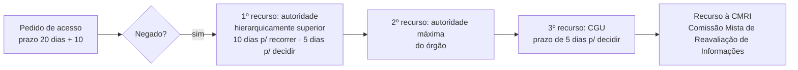

- **Transparência ativa** (o órgão publica sem ser pedido) × **passiva** (responde a pedidos).
- **Portal da Transparência** (gerido pela CGU desde 2004): despesas, transferências, servidores, sanções (CEIS/CNEP), cartões de pagamento, emendas parlamentares.
- **Portal Brasileiro de Dados Abertos** e **Política de Dados Abertos** (Decreto 8.777/2016).
- **Parceria para Governo Aberto (OGP)**: a CGU coordena os **planos de ação nacionais**.

> [!NOTE] Verificar:
> Prazos recursais da LAI conferir no Decreto 7.724/2012 (arts. 21 a 24): o 2º recurso à autoridade máxima é previsto no decreto, não na lei. A CMRI decide em última instância administrativa.

### 7.6 🛡️ Integridade pública e prevenção

- **Programas de integridade** em todos os órgãos federais (Sitai, Decreto 11.529/2023): compromisso da alta administração, **unidade de gestão da integridade**, análise de riscos à integridade, canais de denúncia, monitoramento.
- **Conflito de interesses** (Lei 12.813/2013): consultas e pedidos de autorização para atividade privada pelo **SeCI**; CGU é competente para os servidores em geral, a **Comissão de Ética Pública (CEP)** para as altas autoridades (art. 8º).
- **Nepotismo**: Decreto 7.203/2010 — CGU fiscaliza.
- **Plano de Integridade e Combate à Corrupção** do governo federal (ciclo 2025–2027).
- **Educação e cidadania**: programas como "Um por Todos e Todos por Um", Concurso de Desenho e Redação, capacitação de conselheiros.

> [!NOTE] Verificar:
> Nome e período exatos do plano federal anticorrupção vigente ("Plano de Integridade e Combate à Corrupção 2025–2027") — confirmar no site da CGU.

### 7.7 🕵️ Inteligência, dados e operações especiais

- **Observatório da Despesa Pública (ODP)** — iniciativa histórica de monitoramento de gastos por cruzamento de bases (hoje no âmbito da **Dir. Pesquisas e Informações Estratégicas**).
- **Monitoramento contínuo dos gastos**, trilhas de auditoria, **malhas** (ex.: benefícios sociais pagos a falecidos, servidores sócios de fornecedores).
- **Evolução patrimonial** de agentes públicos → base para **sindicância patrimonial**.
- **Operações especiais** com PF e MPF: a CGU entra com a **análise técnica** (sobrepreço, superfaturamento, direcionamento); a polícia, com as medidas cautelares penais.
- Intercâmbio com o **Coaf** (inteligência financeira).

---

## 🔄 8. Como a CGU fiscaliza: o ciclo de um trabalho

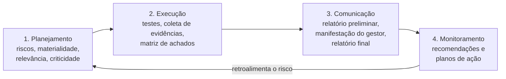

### 8.1 Planejamento
- **Plano Anual de Auditoria Interna (PAINT)** nas Audins; na CGU, planejamento por **matriz de riscos**.
- Critérios de priorização: **risco**, **materialidade** (valor envolvido), **relevância** (social/política) e **criticidade**.
- Para cada trabalho: **objetivo**, **escopo**, **critérios** (o "deveria ser": lei, norma, boa prática) e **questões de auditoria**.

### 8.2 Execução
- Técnicas: análise documental, **inspeção física (in loco)**, entrevista, questionário, **circularização** (confirmação com terceiros), **cruzamento de dados**, amostragem, conferência de cálculos, observação.
- **Matriz de achados**: **Critério** (o que deveria ser) × **Condição** (o que é) × **Causa** × **Efeito** → **Recomendação**.
- **Evidência**: **suficiente** (quantidade), **adequada/relevante** (relação com o achado) e **confiável** (fonte, independência).

> [!IMPORTANT]
> O edital (Fundamentos de auditoria, 3.2): "distinção entre **sinal de risco, evidência e conclusão**". Um alerta de cruzamento de dados (ex.: empresa aberta 1 mês antes da licitação) é **sinal de risco**, não prova. Precisa de **aprofundamento** antes de virar achado, e a afirmação no relatório tem de ser **proporcional** à evidência.

### 8.3 Comunicação
- **Relatório preliminar** → **manifestação do gestor** (contraditório técnico) → **relatório final**, em regra **publicado** no Portal da CGU / e-Aud (respeitando sigilos legais e dados pessoais).
- Recomendações devem atacar a **causa**, não só o sintoma.

### 8.4 Monitoramento
- Acompanhamento das recomendações pelo sistema **e-Aud**.
- Distinguir: **plano de ação** (o gestor promete) → **implementação** (fez) → **resultado** (mudou o problema) → **benefício** (financeiro ou não financeiro, contabilizado pela CGU).

### 8.5 Fiscalização de recursos federais em estados e municípios
- **Programa de Fiscalização em Entes Federativos** (sucessor dos **sorteios públicos de municípios**, 2003–2015): seleção por **matriz de vulnerabilidade**/risco.
- Objeto: recursos federais **transferidos** (fundo a fundo do SUS, FNDE/Fundeb complementação, PNAE — merenda, PNATE — transporte escolar, Bolsa Família, convênios e transferências especiais).
- Resultado vai para **gestor federal** concedente, **TCU**, **MPF**, **AGU** (ressarcimento) e câmaras municipais.

> [!NOTE] Verificar:
> Nome atual do programa de fiscalização em entes federativos e período exato dos sorteios (2003–2015) — confirmar no site da CGU.

---

## 🧩 9. A atuação integrada

Este é o coração do item 5 de "Fundamentos de auditoria governamental e **atuação integrada da CGU**". A CGU não são caixas separadas: **o produto de uma função é o insumo da outra**.

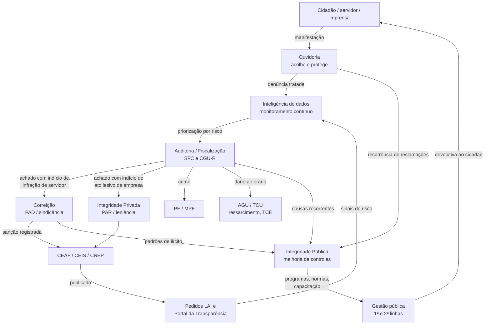

**Exemplo narrativo (para treinar a discursiva)**
1. Uma **denúncia anônima** chega pelo **Fala.BR** sobre a merenda escolar de um município → a **ouvidoria** preserva a identidade e encaminha.
2. A **inteligência de dados** cruza CNPJ das fornecedoras com bases de sócios e servidores e encontra o sócio de uma delas **casado com a secretária municipal** → **sinal de risco**.
3. A **CGU-R** inclui o município na **fiscalização** e faz **inspeção in loco**: produtos não entregues, preços acima do mercado → **achados com evidência**.
4. Encaminhamentos: **MPF/PF** (possível crime, operação especial), **FNDE** (gestor federal, suspensão de repasse/TCE), **TCU**, **AGU** (ressarcimento); se houver servidor **federal** envolvido → **CRG**; a **empresa** pode responder a **PAR** (Lei 12.846) se lesar a administração federal.
5. Os achados alimentam a **integridade**: nova orientação ao FNDE sobre controles do PNAE; dados publicados no **Portal da Transparência**.

> [!TIP]
> Na discursiva (situação-problema de 60 linhas), a banca costuma premiar quem **separa os papéis**: quem **recebe**, quem **apura**, quem **decide/sanciona**, quem **previne** — e quais **garantias** (contraditório, proteção do denunciante, LGPD, sigilo) valem em cada etapa.

---

## ⚖️ 10. CGU × TCU × outros órgãos de controle

| Critério | **CGU** | **TCU** |
|---|---|---|
| Tipo de controle | **Interno** (do Executivo sobre si mesmo) | **Externo** (Legislativo, com auxílio do TCU) |
| Base constitucional | Arts. 70 e 74 | Arts. 70, 71 a 73 |
| Natureza | **Ministério** do Poder Executivo | Órgão **autônomo** que auxilia o Congresso |
| Abrangência | **Executivo federal** + recursos federais transferidos | Todos os **Poderes** da União + recursos federais |
| Julga contas? | **Não**. Certifica, audita e emite parecer | **Sim** (art. 71, II) |
| Aplica sanção a gestor por irregularidade de contas? | Não (aplica sanção **disciplinar** via correição e **a empresas** via PAR) | **Sim** (multa, inabilitação, débito — art. 71, VIII) |
| Relação | Apoia o controle externo e **dá ciência** de irregularidades sob pena de **responsabilidade solidária** (art. 74, § 1º) | Recebe os trabalhos da CGU (ex.: auditoria de contas, PCPR) |

**Outros atores com quem a CGU se articula**
- **Polícia Federal** e **Ministério Público Federal** → operações especiais, crimes.
- **AGU** → ações de ressarcimento, improbidade, coautoria nos acordos de leniência.
- **Receita Federal**, **Coaf** → dados fiscais e financeiros (compartilhamento **lícito**).
- **Comissão de Ética Pública** → conflito de interesses de altas autoridades.
- **ENCCLA** (Estratégia Nacional de Combate à Corrupção e à Lavagem de Dinheiro) → rede interinstitucional.
- **Controles internos estaduais e municipais** (Conaci) → cooperação técnica.
- **Organismos internacionais**: Convenção da **OCDE** sobre suborno transnacional, **UNCAC** (ONU), **Convenção Interamericana** (OEA/MESICIC), **G20** (grupo anticorrupção).

---

## 🧰 11. Ferramentas, sistemas e produtos

| Sistema / produto | Para que serve | Quem mais usa |
|---|---|---|
| **e-Aud** | Gestão dos trabalhos de auditoria e **monitoramento de recomendações** | Auditoria (Cargo 1); desenvolvido/mantido pela TI |
| **Fala.BR** | Plataforma integrada de **ouvidoria e acesso à informação** | OGU, SNAI, ouvidorias de todo o país |
| **Portal da Transparência** | Publicação de gastos, servidores, sanções, transferências | Cidadão; mantido pela CGU |
| **Portal de Dados Abertos** | Catálogo de bases abertas do governo | Pesquisadores, imprensa |
| **CEIS / CNEP / CEPIM / CEAF** | Cadastros de **sancionados** (empresas, entidades sem fins lucrativos impedidas, servidores expulsos) | Licitações, correição |
| **e-PAD / CGU-PAD** | Registro de **processos disciplinares** | Corregedorias |
| **SeCI** | Consultas e pedidos de autorização sobre **conflito de interesses** | Servidores; Sec. Integridade Pública |
| **Alice** (Analisador de Licitações, Contratos e Editais) | Robô que **lê editais** publicados e aponta riscos (direcionamento, sobrepreço) | Auditoria + Ciência de Dados |
| **Painéis gerenciais** (ex.: painel de emendas, de licitações, de compras) | Visualização de dados para gestores e controle social | Todos |

> [!NOTE] Verificar:
> A lista de sistemas é de conhecimento geral; nomes podem ter mudado (ex.: e-PAD substituindo o CGU-PAD). Confirmar no site da CGU antes de citar na discursiva.

---

## 👔 12. O cargo de AFFC: atribuições legais

O AFFC pertence à **Carreira de Finanças e Controle** (junto com o **Técnico Federal de Finanças e Controle — TFFC**). A mesma carreira existe na **STN** (Tesouro), o que explica por que a Lei 9.625/1998, art. 22, mistura atribuições de **controle** (CGU) e de **finanças** (Tesouro).

**Lei 9.625/1998, art. 22 — o que toca a CGU** (planejamento, supervisão, coordenação, orientação e execução):
- I → no **Sistema de Controle Interno**: avaliar metas do **PPA**, execução de **programas** e **orçamentos**, **qualidade do gasto** e a gestão dos administradores, **por meio de auditoria e fiscalização**;
- IV → no **Sistema de Correição**: **prevenção e apuração de irregularidades**;
- VIII → **transparência pública e ouvidoria** na CGU.
- (II, III, V, VI e VII são do lado **Tesouro/Fazenda**: contabilidade federal, programação financeira, dívida pública, estatísticas fiscais.)

**Portaria CGU 814/2020 — atribuições do AFFC na CGU (art. 2º, resumidas)**

| Grupo | Atribuições (incisos) |
|---|---|
| Auditoria e apuração | I (auditoria interna e apuração), II (inspeções), XII (supervisão das Audins, ouvidorias e corregedorias) |
| Orientação aos órgãos | IV (riscos, controles, integridade, transparência, ouvidoria, correição), VI (diretrizes dos sistemas) |
| Ouvidoria | III (recepção, triagem e instrução de manifestações e recursos) |
| Correição e empresas | V (avaliar programas de integridade em leniência), IX (comissões de leniência), XIII (**presidir** processos correcionais **avocados**) |
| Investigação | X (ações investigativas) |
| Contas e finanças | VIII (PCPR e Relatório de Gestão Fiscal), XI (novação de dívida) |
| **Tecnologia** | **VII (prospecção e desenvolvimento de soluções de tecnologia para as atividades finalísticas)** |

> [!IMPORTANT]
> **Diferença AFFC × TFFC** (Portaria 814/2020, art. 3º, § 1º): só o **AFFC supervisiona e coordena** atividades finalísticas; o TFFC executa (salvo se ocupar cargo em comissão/função comissionada). O TFFC **pode presidir comissão de PAD** (§ 2º), **exceto** nos processos **avocados pela CGU** (que o art. 2º, XIII reserva ao AFFC).

> [!TIP]
> O cargo é **um só** (AFFC) com **quatro especialidades**. As atribuições legais são **comuns** a todas. A especialidade define o **perfil de entrada** e a lotação inicial provável, não um "cargo diferente": um AFFC de TI pode compor equipe de auditoria e um AFFC de Auditoria pode trabalhar com dados.

---

## 🧑‍💼 13. Como cada especialidade contribui

> [!NOTE]
> As lotações prováveis abaixo são **dedução** a partir da estrutura regimental e das atribuições; a lotação real depende da CGU no momento da posse. Pelo edital, os Cargos 2, 3 e 4 têm vagas só no **Órgão Central – DF**; o Cargo 1 também nas **Unidades Regionais**.

### 13.1 Visão de conjunto

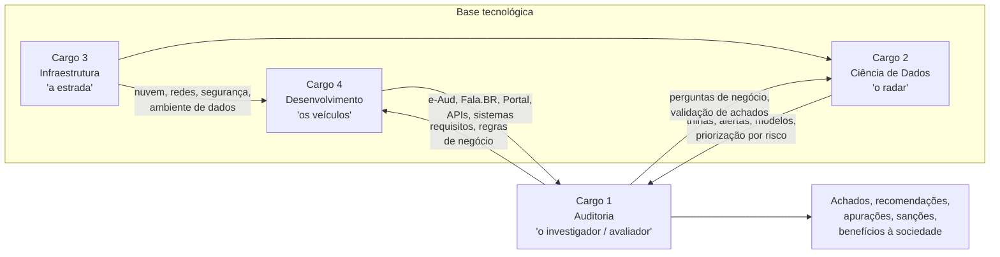

### 13.2 Matriz especialidade × macrofunção da CGU

| Macrofunção | 🔍 Cargo 1 – Auditoria | 📊 Cargo 2 – Ciência de Dados | 🖧 Cargo 3 – Infraestrutura | 💻 Cargo 4 – Desenvolvimento |
|---|---|---|---|---|
| **Auditoria / fiscalização** | Planeja e executa avaliações, consultorias e apurações; escreve relatórios; fiscaliza in loco | Trilhas de auditoria, amostragem estatística, modelos de risco para selecionar o que auditar | Ambientes seguros para dados sigilosos de auditoria; **auditoria de TI** de órgãos (continuidade, segurança) | e-Aud e ferramentas de apoio; **auditoria de sistemas** e contratações de software do governo |
| **Correição / PAR / leniência** | Instrui e preside processos; avalia programas de integridade em leniência; calcula dano e multa | Análise de evolução patrimonial; detecção de cartéis e conluio em licitações; análise de redes de empresas | Cadeia de custódia de evidências digitais; ambientes de perícia; *logs* | Sistemas de processo (e-PAD), cadastros CEIS/CNEP, integração com outros órgãos |
| **Ouvidoria** | Triagem e instrução de denúncias; insumos de risco | **PLN** para classificar manifestações, detectar recorrência e subnotificação | Disponibilidade e segurança do Fala.BR; proteção da identidade do denunciante | Evolução do Fala.BR; acessibilidade e linguagem cidadã na interface |
| **Transparência / LAI** | Julgamento técnico de recursos; avaliação da transparência dos órgãos | Qualidade e anonimização de bases abertas; risco de reidentificação | Hospedagem e escala do Portal da Transparência e Dados Abertos | APIs públicas, portais, painéis |
| **Integridade** | Avalia programas de integridade; recomendações baseadas em causas | Indicadores de risco à integridade; conflito de interesses por cruzamento | Segurança da informação como componente de integridade | SeCI, sistemas de monitoramento de planos de integridade |
| **Inteligência / operações** | Análise de sobrepreço, superfaturamento, direcionamento; apoio a operações com PF/MPF | Cruzamento massivo (CNPJ, RAIS, CadÚnico, SIAFI, ComprasGov); detecção de anomalias; IA generativa assistiva | *Data lake*, *clusters*, governança de acesso, LGPD | Robôs como **Alice**, *pipelines* e integração de bases |

### 13.3 🔍 Cargo 1 — Auditoria (o "coração" da atividade-fim)
**Onde trabalha:** SFC (diretorias temáticas, Dir. Investigações e Operações), CRG, Sec. Integridade Privada, Sec. Integridade Pública, OGU, SNAI e **Controladorias Regionais**.

**Como contribui:**
- **Avalia a gestão e as políticas públicas** → responde se o dinheiro chega, se o programa tem resultado (CF, art. 74, I e II).
- **Apura irregularidades** com rigor probatório → transforma **sinal de risco** em **evidência** e **achado**.
- **Faz a ponte** entre a técnica e a responsabilização: seus relatórios subsidiam PAD, PAR, leniência, TCE, ações da AGU e do MPF.
- **Orienta gestores** (consultoria, capacitação), fortalecendo a 1ª e 2ª linhas sem assumir a gestão.
- **Mede benefícios** financeiros e não financeiros da atuação da CGU.
- **Coordena a PCPR** e auditoria de contas; analisa atos de pessoal.

**Edital que conversa com isso (P3):** auditoria governamental (avaliação, consultoria, apuração); finanças públicas, orçamento e contabilidade pública; políticas públicas e métodos de investigação e avaliação; auditoria de contratações, transferências e execução de recursos; integridade, transparência e responsabilização.

**Perfil de competência:** ceticismo profissional, escrita clara (relatório!), raciocínio jurídico-contábil, trabalho de campo, ética e independência.

### 13.4 📊 Cargo 2 — TI: Ciência de Dados (o "radar")
**Onde trabalha (provável):** **Dir. Pesquisas e Informações Estratégicas** (SE), núcleos de dados da SFC e da CRG, laboratórios de inovação.

**Como contribui:**
- **Monitoramento contínuo dos gastos** (Decreto 11.330, art. 11) → trilhas e alertas automáticos (pagamentos a falecidos, fornecedor recém-criado, fracionamento de despesa).
- **Priorização por risco**: modelos que dizem **onde** a auditoria deve ir → o Cargo 1 trabalha menos "no escuro".
- **Detecção de fraude e conluio**: análise de redes (sócios em comum, endereços), *outliers* de preço, padrões de propostas em licitações.
- **Evolução patrimonial**: cruzamento de declarações, bens e renda → base para sindicância patrimonial.
- **PLN e IA** em ouvidoria e auditoria: classificar manifestações, ler editais (Alice), resumir processos, com **IA responsável** (viés, explicabilidade, supervisão humana).
- **Avaliação de políticas públicas** com métodos quantitativos (inferência causal, séries temporais).
- **Qualidade e governança de dados** (Portaria 814/2020, art. 3º, VI e VII).

**Edital (P3):** estatística, programação e análise de dados; engenharia, arquitetura e governança de dados; aprendizado de máquina e IA; operação e governança de soluções de dados e IA.

> [!WARNING]
> Ponto sensível de prova e da prática: um modelo gera **sinal de risco**, **não** conclusão. Usar resultado de algoritmo como prova única de irregularidade viola o **devido processo** e a **proporcionalidade**. E o cruzamento de bases exige **base legal, finalidade e salvaguardas** (LGPD — Lei 13.709/2018).

### 13.5 🖧 Cargo 3 — TI: Infraestrutura (a "estrada")
**Onde trabalha (provável):** **Diretoria de Tecnologia da Informação** (SE); apoio a equipes de **auditoria de TI** e de operações.

**Como contribui:**
- **Mantém a CGU no ar**: redes, servidores, **nuvem**, virtualização, automação → Fala.BR, Portal da Transparência e e-Aud não podem cair (são serviços ao cidadão e ao controle).
- **Ambiente de dados seguro**: o *data lake* da CGU reúne bases sigilosas (fiscais, bancárias por decisão judicial, de pessoal) → controle de acesso, criptografia, trilhas de auditoria, segregação.
- **Cibersegurança e privacidade**: a CGU é alvo natural (guarda denúncias e dados de investigações); proteção da **identidade do denunciante** depende disso.
- **Continuidade de serviços**: planos de recuperação de desastre, *backup*.
- **Apoio a operações e perícia digital**: coleta e preservação de evidências digitais (cadeia de custódia) em operações especiais.
- **Auditoria de TI** em outros órgãos: avaliar segurança, contratos de nuvem, governança de TI no Executivo federal (tema recorrente da Dir. Governança e Gestão da SFC).

**Edital (P3):** redes, sistemas e plataformas de dados; nuvem, virtualização e automação; cibersegurança, privacidade e continuidade; operação, governança e gestão de serviços digitais.

### 13.6 💻 Cargo 4 — TI: Desenvolvimento de Sistemas (os "veículos")
**Onde trabalha (provável):** **Diretoria de Tecnologia da Informação** (SE), fábricas/equipes de produto das áreas finalísticas.

**Como contribui:**
- **Constrói os sistemas da atividade-fim**: e-Aud (auditoria), Fala.BR (ouvidoria e LAI), e-PAD (correição), SeCI (conflito de interesses), cadastros CEIS/CNEP, Portal da Transparência.
- **Integra bases** de outros órgãos por **APIs** (SIAFI, ComprasGov, Receita) → sem isso o Cargo 2 não tem dados.
- **Transparência como produto**: APIs públicas do Portal, dados abertos legíveis por máquina, interfaces acessíveis em **linguagem cidadã**.
- **Desenvolvimento seguro** (privacy by design, *DevSecOps*): sistemas que lidam com denúncias e processos sigilosos.
- **Automação do controle**: robôs como Alice, *workflows* que reduzem trabalho manual dos auditores.
- **Auditoria de sistemas e de contratações de software** do governo (qualidade, métricas, fábricas de software).
- Atribuição expressa do cargo: **"prospecção e desenvolvimento de soluções de tecnologia que suportem as atividades finalísticas"** (Portaria 814/2020, art. 2º, VII).

**Edital (P3):** engenharia de software e programação; arquitetura e integração de sistemas; persistência, integração e proteção de dados; desenvolvimento seguro, qualidade e gestão da entrega.

### 13.7 Síntese em uma tabela

| Especialidade | Metáfora | Entrega principal à sociedade | Unidade provável |
|---|---|---|---|
| **1 – Auditoria** | Investigador / avaliador | Achados, recomendações, apurações, sanções → **melhoria da gestão e recuperação de recursos** | SFC, CRG, Integridade, OGU, SNAI, **CGU-R** |
| **2 – Ciência de Dados** | Radar | **Saber onde olhar**: risco, alerta, prioridade | Dir. Pesquisas e Informações Estratégicas |
| **3 – Infraestrutura** | Estrada | **Serviços digitais estáveis e seguros**, dados protegidos | Dir. Tecnologia da Informação |
| **4 – Desenvolvimento** | Veículos | **Sistemas e portais** que viabilizam controle e controle social | Dir. Tecnologia da Informação |

> [!TIP]
> **Para a discursiva de qualquer especialidade:** mostrar que você entende **o ecossistema** (quem recebe, quem apura, quem decide, quem previne) e **onde sua especialidade entra** é um diferencial. A banca cobra no básico, para todos os cargos, "Fundamentos de auditoria governamental e **atuação integrada da CGU**".

---

## ⚠️ 14. Pegadinhas de prova

> [!WARNING]
> **"A CGU exerce controle externo sobre o Poder Executivo."** → **Errado.** A CGU faz **controle interno** do Executivo. Controle externo = Congresso com auxílio do TCU.

> [!WARNING]
> **"A CGU julga as contas dos administradores públicos federais."** → **Errado.** Quem **julga** contas é o **TCU** (CF, art. 71, II). A CGU **audita, certifica e emite parecer**.

> [!WARNING]
> **"Ao tomar conhecimento de irregularidade, o responsável pelo controle interno pode, a seu critério, comunicar o TCU."** → **Errado.** É **dever** dar ciência, **sob pena de responsabilidade solidária** (CF, art. 74, § 1º).

> [!WARNING]
> **"A auditoria interna, ao constatar irregularidade, aplica a sanção ao servidor."** → **Errado.** A auditoria **recomenda e encaminha**; a sanção exige **processo correcional** com contraditório e ampla defesa, decidido pela autoridade competente.

> [!WARNING]
> **"Na consultoria, a auditoria interna assume a responsabilidade pelas decisões de gestão."** → **Errado.** Consultoria preserva a **autonomia** e a **responsabilidade do gestor**; o auditor não assume função de gestão.

> [!WARNING]
> **"As CISETs integram a estrutura da CGU."** → **Errado.** São **órgãos setoriais** do Sistema de Controle Interno, nos respectivos ministérios, **sob supervisão técnica** da CGU.

> [!WARNING]
> **"A ouvidoria é responsável por apurar as denúncias recebidas."** → **Errado.** A ouvidoria **acolhe, trata e encaminha**; a apuração cabe à unidade competente (corregedoria, auditoria, polícia).

> [!WARNING]
> **"O acordo de leniência isenta a pessoa jurídica da obrigação de reparar o dano."** → **Errado.** Lei 12.846, art. 16, § 3º: **não exime** da reparação integral.

> [!WARNING]
> **"A baixa quantidade de denúncias em um órgão demonstra que ele tem poucos problemas de integridade."** → **Errado** (ou, no mínimo, não se pode concluir isso). O edital cobra a "distinção entre **baixa ocorrência** e **baixa detecção**" → poucas denúncias podem indicar **subnotificação**, medo de retaliação ou canal ineficaz.

> [!WARNING]
> **"Um alerta gerado por cruzamento de dados é, por si só, evidência suficiente para concluir pela irregularidade."** → **Errado.** É **sinal de risco**; exige aprofundamento e evidência **suficiente, adequada e confiável**.

> [!WARNING]
> **"As Controladorias Regionais da União são subordinadas à SFC."** → **Errado** pelo Decreto 11.330/2023 (art. 32): são subordinadas à **Secretaria-Executiva**, com **supervisão técnica** das unidades centrais.

> [!WARNING]
> **"O Técnico Federal de Finanças e Controle pode supervisionar e coordenar as atividades finalísticas da CGU."** → **Errado** como regra (Portaria 814/2020, art. 3º, § 1º), salvo no exercício de cargo em comissão ou função comissionada.

---

## 🃏 Flashcards
→ Ainda **não** foram criados cards para este tema (regra do repositório: só quando o Eduardo pedir).
Sugestões de cards, quando quiser: as 11 áreas de competência; os 4 sistemas e seus órgãos centrais; avaliação × consultoria × apuração; CGU × TCU; subordinação das CGU-R; leniência (requisitos e efeitos); fluxo recursal da LAI; AFFC × TFFC.

---

## ❓ 15. Questões de fixação (estilo Cebraspe)

> Itens **elaborados pelo Claude** no estilo Certo/Errado da banca (não são questões oficiais).

1. A CGU, órgão central do sistema de controle interno do Poder Executivo federal, possui competência para julgar as contas dos responsáveis por bens e valores públicos federais.
   

Gabarito
<b>Errado.</b> Julgar contas é competência do TCU (CF, art. 71, II). A CGU audita e certifica.

2. Avaliação e consultoria são serviços de auditoria interna governamental, ao passo que a apuração de atos e fatos com indícios de ilegalidade na utilização de recursos públicos federais é competência do sistema de controle interno.
   

Gabarito
<b>Certo.</b> Reproduz a lógica do edital (Fundamentos de auditoria, 1.2) e do Referencial Técnico.

3. No modelo das três linhas, cabe à auditoria interna a responsabilidade primária pela gestão dos riscos das políticas públicas, por ser a instância dotada de maior independência.
   

Gabarito
<b>Errado.</b> O dono do risco é a gestão (1ª linha). A auditoria interna (3ª linha) avalia e assessora com independência.

4. As Controladorias Regionais da União nos estados são unidades descentralizadas da CGU subordinadas à Secretaria-Executiva, sujeitando-se à supervisão técnica das unidades centrais.
   

Gabarito
<b>Certo.</b> Decreto 11.330/2023, Anexo I, art. 32.

5. Recebida denúncia pela ouvidoria, esta deverá apurar os fatos e, se comprovados, encaminhar a proposta de sanção à autoridade competente.
   

Gabarito
<b>Errado.</b> A ouvidoria acolhe, protege o denunciante, trata e encaminha; a apuração é das unidades competentes.

6. No âmbito do Poder Executivo federal, a CGU tem competência para celebrar acordos de leniência com pessoas jurídicas responsáveis por atos lesivos previstos na Lei nº 12.846/2013, e a celebração do acordo não exime a pessoa jurídica da obrigação de reparar integralmente o dano causado.
   

Gabarito
<b>Certo.</b> Lei 12.846/2013, art. 16, § 3º e § 10.

7. Um baixo número de denúncias de assédio registradas em determinado órgão permite concluir que o ambiente de trabalho é íntegro e dispensa medidas adicionais de prevenção.
   

Gabarito
<b>Errado.</b> Baixa ocorrência registrada ≠ baixa ocorrência real (subnotificação, medo de retaliação).

8. O resultado de um modelo de aprendizado de máquina que aponte alta probabilidade de fraude em contrato administrativo constitui sinal de risco que pode orientar a priorização de auditoria, mas não substitui a produção de evidências suficientes e confiáveis.
   

Gabarito
<b>Certo.</b> Distinção entre sinal de risco, evidência e conclusão (edital, Fundamentos de auditoria, 3.2).

9. Os responsáveis pelo controle interno que, ao tomarem conhecimento de irregularidade, deixarem de dar ciência ao TCU responderão solidariamente.
   

Gabarito
<b>Certo.</b> CF, art. 74, § 1º.

10. As secretarias de controle interno dos Ministérios da Defesa e das Relações Exteriores integram a estrutura organizacional da CGU como unidades descentralizadas.
    

Gabarito
<b>Errado.</b> As CISETs são órgãos setoriais do sistema, na estrutura dos respectivos órgãos; as unidades descentralizadas da CGU são as Controladorias Regionais.

11. Na atividade de consultoria, a auditoria interna governamental deve preservar sua autonomia técnica e não assumir responsabilidades próprias da gestão.
    

Gabarito
<b>Certo.</b> Edital, Fundamentos de auditoria, 2.3; Referencial Técnico.

12. A CGU é órgão central do Sistema de Correição do Poder Executivo federal, competindo-lhe, entre outras atribuições, avocar procedimentos disciplinares em curso em outros órgãos.
    

Gabarito
<b>Certo.</b> Decreto 5.480/2005; Decreto 11.330/2023 (CRG); Portaria 814/2020, art. 2º, XIII.

---

## 🔗 Ver também
- [Edital CGU 2026 — Anexo IV (atribuições)](../concursos/cgu-affc/edital/edital-cgu-2026-12.md#anexo-iv)
- [Ficha do concurso CGU-AFFC](../concursos/cgu-affc/README.md)
- Próximas notas sugeridas para a biblioteca de fundamentos: *Controle interno × externo × social*; *Modelo das três linhas e gestão de riscos*; *Lei Anticorrupção e leniência em mapa*; *Ciclo da auditoria governamental*.
