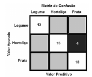

> Texto-base / comando: [[ceb-2022-petrobras-cd-tb02]]

**52** A matriz de confusão a seguir apresenta três rótulos de classe; os elementos diagonais representam o número de pontos para os quais o rótulo previsto é igual ao rótulo verdadeiro, enquanto qualquer coisa fora da diagonal teve um rótulo atribuído erroneamente pelo classificador. Quanto menores forem os valores diagonais da matriz de confusão, melhor o modelo adotado.

*Figura: “Matriz de Confusão” — linhas = Valor Apurado (Legume, Hortaliça, Fruta); colunas = Valor Preditivo (Legume, Hortaliça, Fruta). Diagonal: 13, 16, 18; célula Hortaliça × Fruta: 4; demais células sem valor.*

## Comentário
> [!NOTE] Comentário pendente.
