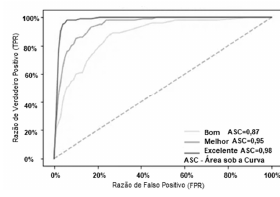

> Texto-base / comando: [[ceb-2022-petrobras-cd-tb02]]

**53** As curvas ROC a seguir mostram a taxa de especificidade (verdadeiros positivos) *versus* a taxa de sensibilidade (falsos positivos) do modelo adotado; a linha tracejada é a linha de base da métrica de avaliação e define uma adivinhação aleatória.

*Figura: três curvas ROC — eixo y “Razão de Verdadeiro Positivo (TPR)”, eixo x “Razão de Falso Positivo (FPR)”; legenda: Bom ASC = 0,87 · Melhor ASC = 0,95 · Excelente ASC = 0,98 (ASC – Área sob a Curva); diagonal tracejada.*

## Comentário
> [!NOTE] Comentário pendente.
