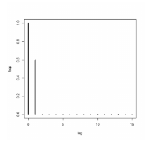

> Texto-base / comando: [[ceb-2022-petrobras-cd-tb13]]

**84** Se a figura abaixo apresenta a forma da função de autocorrelação parcial (facp) da série temporal {*Xₜ*}, na qual as correlações parciais são nulas nos *lags* iguais ou superiores a 2, então a autocorrelação entre *Xₜ* e *Xₜ₋₄* é igual a zero.

*Figura: facp com valor 1,0 no lag 0, cerca de 0,6 no lag 1 e valores nulos dos lags 2 a 15.*

## Comentário
> [!NOTE] Comentário pendente.
