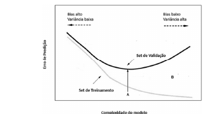

*Figura: eixo y “Erro de Predição”, eixo x “Complexidade do modelo”; curva “Set de Treinamento” decrescente; curva “Set de Validação” em U; ponto **A** no mínimo da curva de validação; região **B** entre as curvas, à direita; à esquerda “Bias alto / Variância baixa”, à direita “Bias baixo / Variância alta”.*

Julgue os próximos itens, considerando o gráfico precedente, que representa as regiões de *overfitting* e de *underfitting*, permitindo uma avaliação do relacionamento da complexidade do modelo de aprendizagem de máquina adotado, com o erro de predição.

---
Itens: [[ceb-2022-petrobras-cd-q054|54]] · [[ceb-2022-petrobras-cd-q055|55]] · [[ceb-2022-petrobras-cd-q056|56]] · [[ceb-2022-petrobras-cd-q057|57]] · Prova: [[questoes/2022-petrobras-ciencia-de-dados/prova|Petrobras 2022 – Ciência de Dados]]
