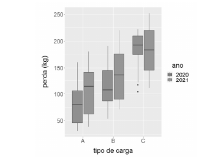

*Figura: desenhos esquemáticos (boxplots) da perda (kg), por tipo de carga (A, B, C) e ano (2020, 2021); no tipo C de 2020 aparecem dois pontos isolados abaixo da caixa.*

Considerando a figura precedente, que mostra desenhos esquemáticos das distribuições das quantidades de cargas perdidas nos anos de 2020 e 2021, segundo o tipo de carga transportada por uma mineradora, julgue os itens que se seguem.

---
Itens: [[ceb-2022-petrobras-cd-q086|86]] · [[ceb-2022-petrobras-cd-q087|87]] · [[ceb-2022-petrobras-cd-q088|88]] · [[ceb-2022-petrobras-cd-q089|89]] · Prova: [[questoes/2022-petrobras-ciencia-de-dados/prova|Petrobras 2022 – Ciência de Dados]]
