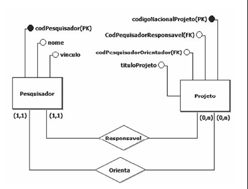

*Figura: MER com as entidades **Pesquisador** (atributos codPesquisador (PK), nome, vinculo) e **Projeto** (codigoNacionalProjeto (PK), CodPesquisadorResponsavel (FK), codPesquisadorOrientador (FK), tituloProjeto), ligadas pelos relacionamentos **Responsavel** e **Orienta**; cardinalidades (1,1) do lado de Pesquisador e (0,n) do lado de Projeto.*

Com base no modelo entidade-relacionamento (MER) precedente, que apresenta a representação das regras de uma instituição de pesquisa, existe um `Pesquisador` cadastrado com o nome `Pedro`. Todos os atributos do MER são do tipo caractere e um dos comandos SQL usados para a construção do modelo é mostrado a seguir.

```sql
create table Projeto
(codNacionalProjeto char(2),
codPesquisadorResponsavel char(2),
codPesquisadorOrientador char(2),
tituloProjeto char(50),
primary key(codNacionalProjeto));
```

A partir das informações constantes no modelo e dos dados sobre o conteúdo dos atributos, julgue os itens subsecutivos.

---
Itens: [[ceb-2022-petrobras-cd-q095|95]] · [[ceb-2022-petrobras-cd-q096|96]] · [[ceb-2022-petrobras-cd-q097|97]] · Prova: [[questoes/2022-petrobras-ciencia-de-dados/prova|Petrobras 2022 – Ciência de Dados]]
