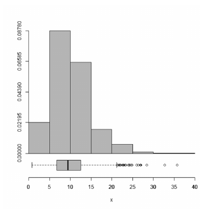

A figura seguinte mostra o histograma como uma estimativa da função de densidade de uma distribuição *X*, juntamente com o diagrama *boxplot* correspondente a esse conjunto de dados.

*Figura: histograma de x (0 a 40) com classes de largura 5 — densidades aproximadas: 0,02195 (0–5), 0,08780 (5–10), 0,06585 (10–15), ≈0,02 (15–20), ≈0,005 (20–25), ≈0,001 (25–30); boxplot abaixo, com mediana próxima de 9–10 e vários outliers à direita (≈21 a 36).*

| | |
|---|--:|
| tamanho da amostra | 1.000 |
| média amostral | 10 |
| desvio padrão amostral | 4,7 |

Considerando a figura e as informações apresentadas no quadro, julgue os itens que se seguem.

---
Itens: [[ceb-2022-petrobras-cd-q113|113]] · [[ceb-2022-petrobras-cd-q114|114]] · [[ceb-2022-petrobras-cd-q115|115]] · Prova: [[questoes/2022-petrobras-ciencia-de-dados/prova|Petrobras 2022 – Ciência de Dados]]
