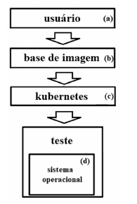

*Figura: retângulos empilhados ligados por setas — (a) usuário → (b) base de imagem → (c) kubernetes → “teste”, que contém (d) sistema operacional.*

Considerando que a figura anterior mostra o *layout* de um *container*, julgue os próximos itens.

---
Itens: [[ceb-2022-petrobras-cd-q118|118]] · [[ceb-2022-petrobras-cd-q119|119]] · [[ceb-2022-petrobras-cd-q120|120]] · Prova: [[questoes/2022-petrobras-ciencia-de-dados/prova|Petrobras 2022 – Ciência de Dados]]
